<div align="center">

<!-- HERO MOTION GRAPHICS BANNER -->


<br/>

<!-- STATUS BADGES -->
[](https://golang.org)
[](https://min.io)
[](https://www.scylladb.com)
[](https://gitea.com)
[](LICENSE)

<br/>

**[⚡ Architecture](docs/ARCHITECTURE.md)** &nbsp;•&nbsp;
**[🛠️ Setup Guide](docs/SETUP_GUIDE.md)** &nbsp;•&nbsp;
**[📜 CQL Schema](deploy/schema.cql)** &nbsp;•&nbsp;
**[🐳 Docker Stack](deploy/docker-compose.yml)** &nbsp;•&nbsp;
**[💬 Report Issue](https://github.com/vaishnosingh/COSMOS/issues)**

<br/>

> 🌌 *"Self-hosted infrastructure that answers to you alone. Private code, infinite storage, zero compromises."*

</div>

---

## 🛰️ Overview

**COSMOS** is a space-themed, self-hosted cloud workstation operating environment engineered to transform old laptops, decommissioned office desktop towers, or home lab computers into high-performance developer workstations.

Instead of paying recurring cloud fees for AWS S3, GitHub private repos, or Cloudflare edge caching, **COSMOS runs the entire workstation directly on your local hardware** with unified Single Sign-On (SSO), automated IAM multi-tenancy, and real-time 3D planetary observability.

---

## ⚡ Core Capabilities

<div align="center">
  
</div>

<br/>

### 🌌 1. Unified Single Sign-On (SSO)
* **One Identity Across Everything:** Single login grants simultaneous access to private S3 storage, Git source control, and CDN workspaces.
* **Zero Plaintext Credentials:** Industry-standard `bcrypt` salted password hashing. Transient registration credentials exist exclusively in temporary, auto-expiring memory buffers (`sync.Map`) during provisioning.
* **Self-Service Recovery:** Integrated OTP verification and expiring password reset tokens.

### 🗄️ 2. Oort Cloud Storage (S3 Engine)
* **S3 API Compatibility:** Native compatibility with AWS CLI, AWS SDKs, Cyberduck, rclone, and Terraform.
* **Automatic IAM Multi-Tenancy:** Each registered account is provisioned with their own MinIO bucket, custom IAM policies (`arn:aws:s3:::cosmos-<id>/*`), and dedicated API access keys.
* **Interactive Browser Console:** Full-featured glassmorphic web console supporting chunked file uploads, object versioning, public URL generation, and vanity CNAME domain mapping.

### 🧑‍💻 3. Source Forge (Git Engine)
* **Private Git Repositories:** Self-hosted code collaboration powered by a lightweight Gitea daemon.
* **Auto-Healing Authentication:** Smart credential synchronization between Cosmos and Gitea's internal database. If credentials ever become mismatched, Cosmos automatically re-synchronizes and authenticates transparently.
* **Full Protocol Support:** Clone, push, and pull effortlessly over HTTPS and SSH (`:2222`).

### ⚡ 4. Sub-Millisecond Edge CDN & Caching
* **In-Memory Cache Layer:** High-concurrency caching proxy with instantaneous sub-millisecond retrieval.
* **HTTP Cache Semantics:** Conditional ETags (`If-None-Match`), `304 Not Modified` responses, and instant cache purge queries (`?nocache=1`).
* **Custom Vanity CNAMEs:** Map custom internet domains directly to specific storage buckets.

### 📊 5. 3D Planetary Telemetry & Observability
* **Interactive Canvas Globe:** Orthographic rotating 3D globe rendered dynamically on HTML5 Canvas showing global request node routing.
* **Real-Time KPI Tracking:** Total request volume, cache hit ratios, origin loads, bandwidth meters, and HTTP error distributions.
* **Historical Time-Series:** Persistent hourly metric aggregations stored in ScyllaDB for telemetry auditing.

---

## 🏗️ System Architecture & Data Flow

<div align="center">
  
</div>

<br/>

Cosmos is structured as a decoupled, multi-tier micro-platform designed for minimal footprint and maximum I/O throughput:

| Layer | Technology | Function |
|---|---|---|
| **Ingress & SSL** | Nginx Reverse Proxy | TLS 1.3 termination, rate limiting, and virtual host routing |
| **Control Plane** | Go (`net/http` daemon) | Identity orchestration, session management, S3 API gateway, and UI rendering |
| **Persistence** | ScyllaDB (CQL NoSQL) | Distributed linear-scale user directory, session indexes, and telemetry |
| **Object Store** | MinIO S3 Engine | High-throughput multi-tenant S3 file storage with automated IAM |
| **Source Engine**| Gitea Git Server | Lightweight Git version control with SSO synchronization |

For detailed CQL schema definitions, IAM access policies, and memory models, see **[ARCHITECTURE.md](docs/ARCHITECTURE.md)**.

---

## 🚀 Quickstart Terminal

<div align="center">
  
</div>

<br/>

### Option A: Launch with Docker Compose (Recommended)

Turn your old PC into a running workstation in under 2 minutes:

```bash
# 1. Clone this repository
git clone https://github.com/vaishnosingh/COSMOS.git
cd COSMOS/deploy

# 2. Configure environment variables (optional, defaults provided)
cp ../.env.example ../.env

# 3. Spin up all containers
docker-compose up -d

# 4. Apply database schema
docker exec -i cosmos-scylla cqlsh < schema.cql
```

Open your browser and navigate to:
```
http://localhost:8080
```

---

### Option B: Native Bare-Metal Installation

For resource-constrained PCs (e.g. 2–4 GB RAM), running bare-metal provides maximum performance:

```bash
# 1. Install prerequisites
sudo apt update && sudo apt install -y golang git nginx curl msmtp

# 2. Apply ScyllaDB / Cassandra schema
cqlsh -f deploy/schema.cql

# 3. Build Cosmos binary
go build -o cosmos .

# 4. Start the systemd service
sudo cp deploy/cosmos.service /etc/systemd/system/
sudo systemctl daemon-reload
sudo systemctl enable --now cosmos
```

Read the step-by-step **[Setup & Deployment Guide](docs/SETUP_GUIDE.md)** for detailed bare-metal configurations, Nginx SSL certificates with Let's Encrypt, and firewall rules.

---

## 💻 Hardware Compatibility

Cosmos runs comfortably on modest or older personal computers:

```
┌─────────────────────────┬──────────────────────────┬─────────────────────────┐
│ Component               │ Minimum Specs            │ Recommended Specs       │
├─────────────────────────┼──────────────────────────┼─────────────────────────┤
│ CPU Processor           │ Dual-core 64-bit x86_64  │ Quad-core Intel / AMD   │
│ System Memory (RAM)     │ 4 GB                     │ 8 GB or 16 GB           │
│ Boot Disk               │ 30 GB SSD                │ NVMe SSD (ScyllaDB)     │
│ Bulk Storage            │ Any internal/USB HDD     │ Multi-terabyte HDD pool │
│ Operating System        │ Debian 11/12, Ubuntu 22+ │ Debian 12 Minimal       │
└─────────────────────────┴──────────────────────────┴─────────────────────────┘
```

---

## 📂 Repository Layout

```ascii
COSMOS/
├── assets/                   # Motion graphics, animated SVGs & diagrams
│   ├── hero.svg              # 3D planet & celestial HUD motion banner
│   ├── architecture.svg      # Animated laser data flow system topology
│   ├── features.svg          # Cosmic panoramic feature cards
│   └── terminal-demo.svg     # Animated CLI quickstart demo
├── deploy/                   # Deployment & orchestration configurations
│   ├── docker-compose.yml    # Complete 4-service container stack
│   ├── Dockerfile            # Lightweight multi-stage Go build
│   ├── nginx.conf            # Production reverse proxy & SSL config
│   ├── cosmos.service        # Systemd daemon unit file
│   └── schema.cql            # ScyllaDB keyspace & table definitions
├── docs/                     # Technical documentation
│   ├── ARCHITECTURE.md       # In-depth architectural specifications
│   └── SETUP_GUIDE.md        # Bare-metal & cloud deployment walkthrough
├── templates/                # Responsive glassmorphic space portals
│   ├── index.html            # Main workstation hub & feature showcase
│   ├── oortconsole.html      # S3 storage browser, 3D globe & metrics
│   ├── login.html            # Unified SSO portal
│   └── signup.html           # Verification & onboarding flow
├── config.go                 # Environment-driven dynamic settings
├── main.go                   # HTTP server, auth router & MinIO broker
├── oortconsole.go            # S3 API endpoints & bucket management
├── oortanalytics.go          # Real-time telemetry & ScyllaDB flushers
├── s3cache.go                # Sub-millisecond in-memory edge cache
├── .env.example              # Sample environment configuration
├── go.mod                    # Dependencies manifest
└── LICENSE                   # MIT License
```

---

## 🛡️ Security & Privacy Guarantee

* **100% Data Sovereignty:** Everything lives on your hardware. No analytics, tracking pings, or telemetry phone-home calls.
* **Isolated IAM Tenants:** S3 buckets are locked down via AWS IAM JSON policies. No user can list or access files belonging to another account.
* **Decoupled Secrets:** Zero hardcoded passwords or domains in source code. All endpoints and credentials are provided dynamically via environment variables.

---

## 📜 License

Distributed under the **MIT License**. See **[LICENSE](LICENSE)** for details.

<div align="center">
  <br/>
  <sub>Designed &amp; Engineered with 🌌 for sovereign developers.</sub>
</div>
