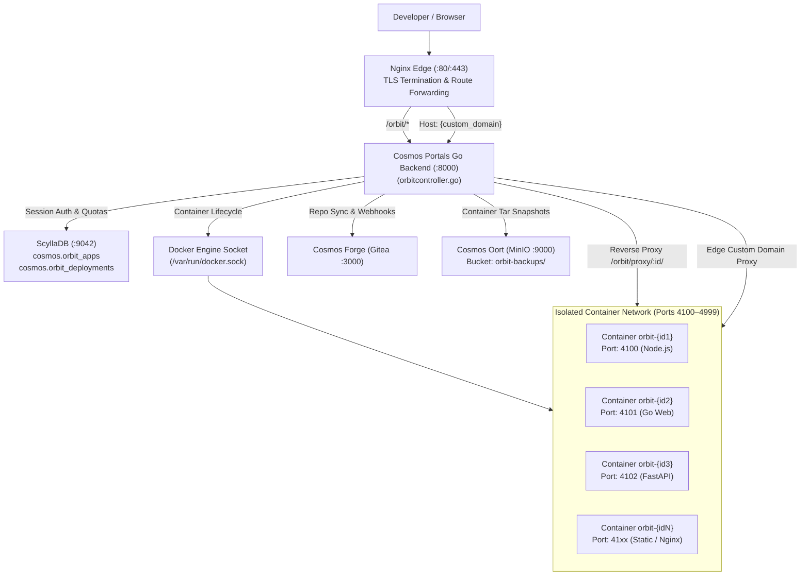

# Cosmos Storage Platform — Complete Technical Documentation

> **Version:** Production (October 2026)
> **Server:** `cosmos.linuxguy.space` / `vshno.linuxguy.space`
> **Maintainer:** System Administrator
> **Last Updated:** October 14, 2026
> **Document Type:** Full Architecture, Operations & Code Reference

---

## Table of Contents

1. [Project Overview & Mission](#1-project-overview--mission)
2. [Infrastructure & Server Setup](#2-infrastructure--server-setup)
3. [Filesystem Layout & Codebase Map](#3-filesystem-layout--codebase-map)
4. [Service Architecture Diagram](#4-service-architecture-diagram)
5. [Nginx — Web Server & Reverse Proxy](#5-nginx--web-server--reverse-proxy)
6. [MinIO — S3-Compatible Object Storage](#6-minio--s3-compatible-object-storage)
7. [ScyllaDB — Database Layer](#7-scylladb--database-layer)
8. [The Go Backend — Cosmos Portals (`portals-go`)](#8-the-go-backend--cosmos-portals-portals-go)
9. [Systemd Services — Boot & Process Management](#9-systemd-services--boot--process-management)
10. [Frontend Templates — Page-by-Page Breakdown](#10-frontend-templates--page-by-page-breakdown)
11. [The Oort Console — S3 Storage Dashboard (SPA)](#11-the-oort-console--s3-storage-dashboard-spa)
12. [Authentication & Session Flow](#12-authentication--session-flow)
13. [File Upload & Multipart Transfer](#13-file-upload--multipart-transfer)
14. [Analytics System](#14-analytics-system)
15. [CDN Proxy & Public File Serving](#15-cdn-proxy--public-file-serving)
16. [MinIO User Provisioning Flow](#16-minio-user-provisioning-flow)
17. [Disk Partitions & Data Storage Locations](#17-disk-partitions--data-storage-locations)
18. [Docker & ScyllaDB Container](#18-docker--scylladb-container)
19. [Gitea — Git Server Integration](#19-gitea--git-server-integration)
20. [Security Posture, Flaws & Recommendations](#20-security-posture-flaws--recommendations)
21. [Boot Sequence & Service Startup Order](#21-boot-sequence--service-startup-order)
22. [Troubleshooting Runbook](#22-troubleshooting-runbook)
23. [API Reference](#23-api-reference)
24. [Database Schema Reference](#24-database-schema-reference)
25. [Environment Variables & Secrets](#25-environment-variables--secrets)
26. [Known Issues & Broken Features](#26-known-issues--broken-features)
27. [Quick Reference: Common Operations](#27-quick-reference-common-operations)
28. [Cosmos Orbit — Application Platform & Container Runtime (PaaS)](#28-cosmos-orbit--application-platform--container-runtime-paas)

---

## 1. Project Overview & Mission

**Cosmos Cloud** is a fully self-hosted, sovereign cloud computing suite built on Debian Linux with zero third-party cloud-provider dependencies. The platform unites three primary computing pillars:

1. **Oort (S3 Object Storage)** — Powered by MinIO, accessible via standard AWS S3 SDK/CLI tools and the reactive Oort Console SPA with analytics and custom CDN domains.
2. **Forge (Git Version Control)** — Powered by self-hosted Gitea, providing fast Git repository hosting, code reviews, issue tracking, and webhook triggers.
3. **Orbit (PaaS & Container Runtime)** — A sovereign application platform providing automated stack detection, Docker container virtualization, 10-port quota allocation (ports 4100–4999), live telemetry, custom domain reverse-proxy routing, and direct Oort S3 backup snapshots.

### Core Capabilities:
- **S3-compatible object storage** — powered by MinIO, accessible via standard AWS S3 SDK/CLI tools and custom web console
- **Web Console (Oort Console)** — a feature-rich, fully mobile-responsive single-page application for managing files, analytics, and account settings
- **Application Platform (Orbit Console)** — high-performance PaaS with space-themed glassmorphic UI, live log streams, and 1-click starter deployments
- **Universal Single Sign-On (SSO)** — unified user database (`cosmos.users`) allowing seamless navigation across Forge, Oort, and Orbit
- **Per-user storage & compute isolation** — isolated MinIO buckets with 10 GB default hard quotas and max 10 container application ports per user
- **Real-time analytics with geographic tracking** — CDN request tracking, per-country read/write stats, timeseries charts, D3.js 3D globe
- **Quota expansion system** — users can request quota increases; admin receives email with approval link
- **CDN proxy layer** — public files served via Go backend with in-memory caching; cache invalidated on upload/delete/move/restore
- **Custom domain support** — users can map custom domains to their buckets for branded static hosting
- **Git hosting** — Gitea self-hosted git server at `/source/`
- **Versioning** — MinIO object versioning enabled per bucket; console allows viewing and restoring previous versions

The platform runs entirely on Debian Linux with Nginx as the edge, MinIO as the S3 engine, ScyllaDB (via Docker) as the metadata store, and a custom Go binary as the application server.

---

## 2. Infrastructure & Server Setup

### VPS Specifications

| Property | Value |
|---|---|
| OS | Debian 12 (Bookworm) |
| User | `debian` |
| Primary domain | `cosmos.linuxguy.space` |
| Legacy domains | `vshno.linuxguy.space`, `debian.linuxguy.space` |
| DNS/CDN | Cloudflare (proxied) — provides SSL termination and DDoS protection |
| SSL (origin) | Self-signed cert at `/etc/nginx/ssl/nginx.crt` (Cloudflare handles public TLS) |
| Cloudflare header | `CF-IPCountry` — used by analytics to geolocate requests by country |
| Internal ports | 8000 (Go), 9000 (MinIO S3 API), 9001 (MinIO Console), 9042 (ScyllaDB), 3000 (Gitea) |
| Public ports | 80, 443 via Nginx |

### Public URL Map

| Path | Service |
|---|---|
| `https://cosmos.linuxguy.space/` | Cosmos landing page (Go → `index.html`) |
| `https://cosmos.linuxguy.space/oort` | Oort Object Storage landing page |
| `https://cosmos.linuxguy.space/oort/login` | Oort user login |
| `https://cosmos.linuxguy.space/oort/signup` | Oort user registration |
| `https://cosmos.linuxguy.space/oort/verify` | OTP email verification (inline HTML) |
| `https://cosmos.linuxguy.space/oort/dashboard` | API credentials dashboard |
| `https://cosmos.linuxguy.space/oort/console` | S3 Storage Console SPA |
| `https://cosmos.linuxguy.space/oort/{username}/{bucket}/{key}` | Public file proxy (via `handleS3PublicProxy`) |
| `https://cosmos.linuxguy.space/git` | Forge (Git) landing page (`git.html`) |
| `https://cosmos.linuxguy.space/git/login` | Forge login with automatic Gitea SSO |
| `https://cosmos.linuxguy.space/git/signup` | Forge registration with OTP verification |
| `https://cosmos.linuxguy.space/git/dashboard` | Forge workspace dashboard |
| `https://cosmos.linuxguy.space/{service}/forgot-password` | Space-themed password reset request (`forgot-password.html`) |
| `https://cosmos.linuxguy.space/{service}/reset-password?token=...` | Password reset execution with strength meter & Gitea sync |
| `https://cosmos.linuxguy.space/source/` | Gitea Git server web interface (proxied) |
| `https://cosmos.linuxguy.space/console/` | MinIO Admin Console |
| `https://cosmos.linuxguy.space/oort/api/quota/approve?token=...` | Admin quota approval link |
| `https://cosmos.linuxguy.space/orbit` | Orbit PaaS Console SPA |
| `https://cosmos.linuxguy.space/orbit/proxy/{app_id}/*` | Dynamic transparent reverse proxy to container |
| `https://cosmos.linuxguy.space/orbit/api/apps` | Orbit apps list & creation API |
| `https://{custom-domain}/*` | Custom domain transparent reverse proxy |

### Active MinIO Buckets

| Bucket | Owner | Type |
|---|---|---|
| `unity-27aa4685` | vaishnosingh9@gmail.com | Default user bucket |
| `unity-0cb36849` | duggalpiyush0@gmail.com | Default user bucket |
| `unity-46288ab0` | admin@vshno.linuxguy.space | Default user bucket |
| `unity-115b2550` | bavaj31068@meonvr.com | Default user bucket |
| `unity-d228e0597dd84a34` | vaishnosingh9@gmail.com | Extra bucket ("tools-suite-models") |
| `cdn-bucket` | system | Legacy CDN bucket |
| `memespace` | system | Legacy meme service bucket |

---

## 3. Filesystem Layout & Codebase Map

```
/home/debian/
├── portals-go/                    ← Main application root
│   ├── portals                    ← Compiled Go binary (run by systemd)
│   ├── main.go                    ← Core entry point: routing, auth, Gitea SSO, password reset, DB setup, custom domain router
│   ├── orbitcontroller.go         ← Orbit PaaS engine: Docker API, buildpacks, proxy, telemetry, custom domains (~1300 lines)
│   ├── oortconsole.go             ← All S3/Oort API handlers (1811 lines, 57.2 KB)
│   ├── oortanalytics.go           ← In-memory metrics + ScyllaDB persistence (145 lines, 4 KB)
│   ├── s3cache.go                 ← CDN proxy in-memory response caching (50 lines, 905 bytes)
│   ├── templates/                 ← Embedded HTML templates (//go:embed)
│   │   ├── orbitconsole.html      ← Orbit PaaS Console SPA (Vercel/Railway layout, orbital background)
│   │   ├── oortconsole.html       ← S3 Storage Console SPA (space-themed dashboard)
│   │   ├── git.html               ← Forge Git landing page
│   │   ├── oort.html              ← Oort Object Storage landing page
│   │   ├── index.html             ← Cosmos Suite root landing page
│   │   ├── forgot-password.html   ← Space-themed password recovery
│   │   └── tailwind.css           ← Pre-compiled utility CSS
│   └── scratch/                   ← Persistent test suites, temporary tar contexts, scripts
│   ├── go.mod                     ← Go module definition (Go 1.25, clean dependencies)
│   ├── go.sum                     ← Dependency checksums
│   ├── cosmos/                    ← Docker Compose for ScyllaDB
│   │   └── docker-compose.yml
│   └── templates/                 ← HTML templates (embedded into binary at compile time)
│       ├── index.html             ← Homepage / landing page (56.8 KB)
│       ├── oort.html              ← Oort service landing page (28.6 KB)
│       ├── oortconsole.html       ← Full S3 Console SPA (575 KB — ~3,500+ lines)
│       ├── login.html             ← Space-themed login page (19.1 KB)
│       ├── signup.html            ← Space-themed signup page (26.5 KB)
│       ├── forgot-password.html   ← Space-themed password reset page with 6 states & sky engine (17.3 KB)
│       ├── cloud.html             ← Cloud Drive service landing (28.4 KB)
│       ├── git.html               ← Git service landing page (31.6 KB)
│       ├── tailwind.css           ← Tailwind CSS framework (2.9 MB)
│       └── tailwind.js            ← Tailwind JS utilities (407 KB)
│
/opt/minio/
└── data/                          ← MinIO object storage data directory
    ├── unity-27aa4685/            ← User bucket: vaishnosingh9@gmail.com
    ├── unity-0cb36849/            ← User bucket: duggalpiyush0@gmail.com
    ├── unity-46288ab0/            ← User bucket: admin@vshno.linuxguy.space
    ├── unity-115b2550/            ← User bucket: bavaj31068@meonvr.com
    ├── unity-d228e0597dd84a34/    ← Extra bucket: vaishnosingh9 (tools-suite-models)
    ├── cdn-bucket/                ← Legacy CDN bucket
    ├── memespace/                 ← Legacy meme service bucket
    └── .minio.sys/                ← MinIO system metadata
│
/etc/systemd/system/
├── portals.service                ← Go backend service definition
└── minio.service                  ← MinIO object storage service
│
/etc/nginx/
├── nginx.conf                     ← Main Nginx config (workers, gzip, SSL protocols)
└── sites-enabled/
    └── debian.linuxguy.space      ← Main virtual host config (all proxy rules)
│
/var/lib/docker/volumes/
└── scylla_scylla-data/            ← ScyllaDB persistent data volume
│
/home/debian/portals-go/cosmos/    ← Docker compose files for ScyllaDB
│
/home/debian/.msmtprc              ← msmtp email configuration (Gmail SMTP)
│
/usr/local/bin/minio               ← MinIO binary (v RELEASE.2024-12-18T13-15-44Z)
/usr/local/bin/mc                  ← MinIO client (mc) for admin operations
```

### Go Module Dependencies (`go.mod`)

```
module portals
go 1.25.0

Direct dependencies:
  github.com/google/uuid v1.6.0          ← UUID generation for sessions
  github.com/mattn/go-sqlite3 v1.14.50   ← SQLite (legacy, NOT actively used in main code path)
  golang.org/x/crypto v0.55.0            ← bcrypt for password hashing

Key indirect dependencies:
  github.com/gocql/gocql v1.7.0          ← ScyllaDB/Cassandra CQL driver
  github.com/minio/minio-go/v7 v7.3.0    ← MinIO S3 client SDK
  golang.org/x/net, sys, text            ← Network/system utilities
```

> [!WARNING]
> `github.com/mattn/go-sqlite3` is listed as a direct dependency in `go.mod`, but SQLite is **not used anywhere** in the current Go source code. The old SQLite data files (`unity_cloud.db`, `unity_git.db`, `unity_s3.db`) have been deleted. This dependency should be removed from `go.mod` to avoid unnecessary CGO compilation overhead.

---

## 4. Service Architecture Diagram

```
                         ┌─────────────────────────────┐
                         │         INTERNET              │
                         │   (User Browser / S3 CLI)     │
                         └──────────────┬────────────────┘
                                        │ HTTPS (via Cloudflare)
                                        │ + CF-IPCountry header
                                        ▼
                         ┌─────────────────────────────┐
                         │     CLOUDFLARE PROXY          │
                         │ (SSL termination, DDoS, CDN)  │
                         └──────────────┬────────────────┘
                                        │ HTTP to origin (self-signed cert)
                                        ▼
┌───────────────────────────────────────────────────────────────────┐
│                         NGINX (:80/:443)                          │
│                   /etc/nginx/sites-enabled/                       │
│  server_name: cosmos.linuxguy.space vshno.linuxguy.space          │
│               debian.linuxguy.space localhost                     │
│  client_max_body_size: 10G                                        │
│                                                                   │
│  Location Rules (in priority order):                              │
│  GET /          → Go Backend     (:8000)                          │
│  POST /         → MinIO S3 API   (:9000)  [418 trick]             │
│  /oort/*        → Go Backend     (:8000)                          │
│  /git/*         → Go Backend     (:8000)                          │
│  /orbit/*       → Go Backend     (:8000)  [PaaS & Container Proxy]│
│  /cdn/*         → Go Backend     (:8000)                          │
│  /tailwind.css  → Go Backend     (:8000)                          │
│  /source/*      → Gitea          (:3000)  [path rewrite]          │
│  /console/*     → MinIO Console  (:9001)  [path rewrite]          │
│  /api/v1/*      → MinIO Console  (:9001)                          │
│  /static/*      → MinIO Console  (:9001)                          │
│  /*             → MinIO S3 API   (:9000)  [S3 catch-all]          │
│                                                                   │
│  Default server (any other domain/subdomain):                     │
│  /*  → rewrite → /oort/api/cdn_proxy/* → Go Backend (:8000)      │
│      → maps custom domain to Orbit App (:4100-4999) or Oort Bucket│
└───────┬──────────────────────┬──────────────────────┬─────────────┘
        │                      │                      │
        ▼                      ▼                      ▼
┌──────────────┐    ┌────────────────────┐    ┌──────────────┐
│ Go Backend   │    │  MinIO Object      │    │  Gitea Git   │
│  (portals)   │    │  Storage           │    │  Server      │
│  :8000       │    │  :9000 (S3 API)    │    │  :3000       │
│  49.2 MB RAM │    │  :9001 (Console)   │    │              │
│              │    │  238.9 MB RAM      │    │ Accessible   │
│ Handles:     │    │                    │    │ at /source/  │
│ - Auth/SSO   │    │ User buckets:      │    │              │
│ - S3 Console │    │  unity-XXXXXXXX    │    │ Starter repos│
│ - Orbit PaaS │    │  (per user)        │    │ webhooks for │
│ - Docker Ops │    │ Data: /opt/minio/  │    │ auto-deploy  │
│ - Analytics  │    │  data/             │    └──────────────┘
│ - CDN Proxy  │    └────────────────────┘
│ - Quotas     │
│ - Domains    │
└───────┬──────┴─────────────────────────┬───────────────────────────┐
        │                                │                           │
        ▼                                ▼                           ▼
┌──────────────────────────────────────┐ │ ┌───────────────────────────────────────┐
│  ScyllaDB (Docker Container)          │ │ │ Orbit App Containers (Docker)         │
│  Container: scylla-scylla-1           │ │ │ Isolated ports: 4100 – 4999           │
│  Port: 9042 (CQL)                     │ │ │ - Node.js Express / Next.js           │
│  Volume: scylla_scylla-data           │ │ │ - Go Web Services (golang:alpine)     │
│                                       │ │ │ - Python FastAPI / Flask              │
│  Keyspace: cosmos                     │ │ │ - Static HTML5/CSS3 / Nginx (SPA)     │
│  Tables:                              │ │ │ Reverse-proxied via:                 │
│  - users          (auth + sessions)   │ │ │ • /orbit/proxy/{app_id}/*             │
│  - pending        (email verification)│ │ │ • Host: {custom-domain}               │
│  - password_reset_tokens (reset links)│ │ └───────────────────────────────────────┘
│  - buckets        (extra buckets)     │ │
│  - s3_analytics   (aggregate metrics) │ │
│  - s3_analytics_hourly (time-series)  │ │
│  - quota_requests (quota approval)    │ │
│  - bucket_domains (custom domains)    │ │
│  - orbit_apps     (app metadata)      │─┘
│  - orbit_deployments (build history)  │
└──────────────────────────────────────┘
```

---

## 5. Nginx — Web Server & Reverse Proxy

### File Location
`/etc/nginx/sites-enabled/debian.linuxguy.space`

### How It Works

Nginx is the **single entry point** for all traffic. It handles:
1. **TLS/SSL termination** — decrypts HTTPS traffic from Cloudflare (re-encrypted to origin)
2. **Reverse proxying** — forwards requests to the correct internal service
3. **Large file uploads** — `client_max_body_size 10G` permits up to 10 GB uploads per request
4. **WebSocket proxying** — for MinIO console real-time updates (Upgrade/Connection headers)

### Key Configuration Details

**Rate Limiting Zones (DDoS & Brute-Force Protection):**
```nginx
# Auth endpoints: 5 requests per minute per IP (burst=10, no delay)
limit_req_zone $binary_remote_addr zone=auth_limit:10m rate=5r/m;
# General API: 60 requests per second per IP
limit_req_zone $binary_remote_addr zone=api_limit:10m rate=60r/s;
```

**Shared server block (all production domains):**
```nginx
server {
    listen 80;  listen [::]:80;
    listen 443 ssl;  listen [::]:443 ssl;
    server_name vshno.linuxguy.space cosmos.linuxguy.space debian.linuxguy.space localhost;
    client_max_body_size 10G;
    ssl_certificate /etc/nginx/ssl/nginx.crt;      # Self-signed (Cloudflare handles public cert)
    ssl_certificate_key /etc/nginx/ssl/nginx.key;
}
```

**Smart Root Location** — discriminates GET (web portal) from POST (S3 API):
```nginx
location = / {
    error_page 418 = @minio_sts;
    if ($request_method = POST) { return 418; }   # Trick: POST → S3
    proxy_pass http://127.0.0.1:8000;              # GET → Go web portal
}
location @minio_sts {
    proxy_pass http://127.0.0.1:9000;              # POST → MinIO S3 API
}
```

**Oort, Git, CDN routes** → Go backend:
```nginx
location = /oort    { proxy_pass http://127.0.0.1:8000; }
location ^~ /oort/  { proxy_pass http://127.0.0.1:8000; }

# Strict Rate Limiting on Authentication Endpoints (5 req/min, burst 10)
location ~* ^/oort/(login|signup|verify)$ {
    limit_req zone=auth_limit burst=10 nodelay;
    limit_req_status 429;
    proxy_pass http://127.0.0.1:8000;
    proxy_set_header Host $http_host;
    proxy_set_header X-Real-IP $remote_addr;
    proxy_set_header X-Forwarded-For $proxy_add_x_forwarded_for;
}

location = /git     { proxy_pass http://127.0.0.1:8000; }
location ^~ /git/   { proxy_pass http://127.0.0.1:8000; }
```

**Gitea Git Server with Auth Redirects:**
```nginx
location = /source/user/forgot_password {
    return 302 /git/forgot-password;
}
location = /source/user/sign_up {
    return 302 /git/signup;
}
location ^~ /source/ {
    proxy_pass http://127.0.0.1:3000/;
    proxy_set_header Host $http_host;
    proxy_set_header X-Real-IP $remote_addr;
    proxy_set_header X-Forwarded-For $proxy_add_x_forwarded_for;
    proxy_set_header X-Forwarded-Proto $scheme;
    proxy_read_timeout 300;
    proxy_send_timeout 300;
}
```

**MinIO Console** — strips `/console/` prefix via rewrite:
```nginx
location ^~ /console/ {
    rewrite ^/console/(.*) /$1 break;       # Strip prefix
    proxy_set_header Upgrade $http_upgrade;
    proxy_set_header Connection "upgrade";   # WebSocket support
    proxy_pass http://localhost:9001;
}
```

**MinIO S3 API catch-all** — unmatched paths hit MinIO directly (enables native S3 SDK usage):
```nginx
location / {
    proxy_set_header Connection "";
    chunked_transfer_encoding off;           # Required for S3 multipart
    proxy_pass http://localhost:9000;
}
```

**Custom domain CDN default-server** — second `server {}` block catches any unknown domain:
```nginx
server {
    listen 80 default_server;
    listen [::]:80 default_server;
    listen 443 ssl default_server;
    listen [::]:443 ssl default_server;
    server_name _;
    location / {
        rewrite ^/(.*)$ /oort/api/cdn_proxy/$1 break;
        proxy_pass http://127.0.0.1:8000;
    }
}
```
This enables users to point a custom domain (e.g., `mysite.com`) at this server's IP, and their bucket files will be served transparently.

### Standard Proxy Headers (on all proxy locations)
```nginx
proxy_set_header Host              $http_host;
proxy_set_header X-Real-IP         $remote_addr;
proxy_set_header X-Forwarded-For   $proxy_add_x_forwarded_for;
proxy_set_header X-Forwarded-Proto $scheme;
```
Additionally, Cloudflare adds:
- `CF-IPCountry` — 2-letter ISO country code of the visitor, used by analytics

---

## 6. MinIO — S3-Compatible Object Storage

### What It Is
MinIO (v RELEASE.2024-12-18T13-15-44Z) is the S3-API-compatible storage engine. Users interact via:
- The Oort Console (through the Go backend)
- Native AWS S3 CLI / SDK tools directly (aws-cli, boto3, rclone, etc.) using the endpoint `https://cosmos.linuxguy.space`
- The MinIO admin console at `/console/`

### Installation Paths
```
Binary:     /usr/local/bin/minio
Client:     /usr/local/bin/mc
Data:       /opt/minio/data/
```

### Service Configuration (`/etc/systemd/system/minio.service`)
```ini
[Unit]
Description=MinIO Object Storage
After=network.target

[Service]
User=root
Environment="MINIO_ROOT_USER=unityadmin"
Environment="MINIO_ROOT_PASSWORD=UnityAdmin2026!"
Environment="MINIO_BROWSER_REDIRECT_URL=https://vshno.linuxguy.space/console/"
Environment="MINIO_SERVER_URL=https://vshno.linuxguy.space"
ExecStart=/usr/local/bin/minio server /opt/minio/data --address ":9000" --console-address ":9001"
Restart=always
```

| Variable | Value | Purpose |
|---|---|---|
| `MINIO_ROOT_USER` | `unityadmin` | Admin username for mc/API access |
| `MINIO_ROOT_PASSWORD` | `UnityAdmin2026!` | Admin password |
| `MINIO_SERVER_URL` | `https://vshno.linuxguy.space` | Public URL for presigned URL generation |
| `MINIO_BROWSER_REDIRECT_URL` | `https://vshno.linuxguy.space/console/` | MinIO console redirect |

### User Isolation Architecture
Each Cosmos user gets:
- **MinIO user account** (access key = their email, secret key = 12-char random hex)
- **Dedicated bucket** named `unity-{8-char-hex}` (default) or `unity-{16-char-hex}` (extra buckets)
- **Policy** named `policy_{bucket}` that restricts them to **only their bucket** (`s3:*` on their bucket ARN only)
- **Hard quota** enforced at the MinIO level (default 10 GB, read by the backend via `mc quota info cosmos/{bucket} --json`)

### Presigned URLs
The backend generates presigned URLs for file preview and download using the **public endpoint** (`cosmos.linuxguy.space`), so the signature matches what the browser requests. Cache TTL:
- Presign: 15 minutes
- Share: 7 days

### Bucket Versioning
Object versioning is enabled on every bucket at creation time (`mc version enable cosmos/{bucket}`). This allows the console to list and restore previous file versions.

### MinIO Client (mc) Admin Commands
```bash
# Set up admin alias (required before any mc commands)
mc alias set cosmos http://127.0.0.1:9000 unityadmin UnityAdmin2026!

# List all users
mc admin user list cosmos

# Add a new user
mc admin user add cosmos USER_EMAIL SECRET_KEY

# Create a bucket
mc mb cosmos/BUCKET_NAME

# Enable versioning
mc version enable cosmos/BUCKET_NAME

# Create a policy
mc admin policy create cosmos POLICY_NAME /path/to/policy.json

# Attach policy to user
mc admin policy attach cosmos POLICY_NAME --user USER_EMAIL

# Set quota
mc quota set cosmos/BUCKET_NAME --size 10G

# Check quota (JSON output, used by backend)
mc quota info cosmos/BUCKET_NAME --json
```

---

## 7. ScyllaDB — Database Layer

### What It Is
ScyllaDB (Cassandra-compatible NoSQL) stores all user metadata, sessions, analytics, and custom domains. The Go backend uses raw CQL queries via `github.com/gocql/gocql`.

### Running Environment
```bash
# Docker container
scylla-scylla-1

# Docker Compose location
/home/debian/portals-go/cosmos/docker-compose.yml

# Data volume (persisted)
/var/lib/docker/volumes/scylla_scylla-data/_data/

# Connect (requires docker access — use Go scripts instead, see troubleshooting)
sudo docker exec -it scylla-scylla-1 cqlsh
```

> [!NOTE]
> The `debian` user does NOT have access to the Docker socket. You cannot run `docker exec` as the `debian` user. Run database queries either as `root` (with `sudo`) or by writing a temporary Go script in `/home/debian/portals-go/` that imports `github.com/gocql/gocql` and runs queries against `127.0.0.1`.

### Keyspaces

| Keyspace | Status | Purpose |
|---|---|---|
| `cosmos` | **ACTIVE** | Primary application keyspace (all live data) |
| `unity` | Legacy/empty | Created by `initDB()` for backward compatibility |
| `system*` | Internal | ScyllaDB system tables |

### All Tables in `cosmos` Keyspace

#### `cosmos.users` — All registered users
```cql
CREATE TABLE cosmos.users (
    service             text,           -- 'oort', 'cdn', 'git'
    email               text,           -- User email (PK part 2)
    name                text,           -- Display name
    password_hash       text,           -- bcrypt hash (cost 12)
    access_key          text,           -- S3 access key (= email for oort)
    secret_key          text,           -- 12-char hex secret
    bucket              text,           -- Default MinIO bucket name
    session_id          text,           -- Active session UUID
    username            text,           -- URL-safe username
    profile_image       text,           -- Base64-encoded JPEG (stored in DB)
    bucket_display_name text,           -- Human-readable bucket name (default: "mybucket")
    created_at          bigint,         -- Unix timestamp for 30-day session expiry enforcement
    PRIMARY KEY ((service, email))
);
-- Secondary indexes:
CREATE INDEX users_session ON cosmos.users (session_id);
CREATE INDEX users_username_idx ON cosmos.users (username);
```

**Note:** Sessions with `created_at > 0` expire after 30 days (`sessionMaxAge = 30 * 24 * time.Hour`). Grandfathered accounts with `created_at = null` remain active.

**Current users:**

| Service | Email | Username | Default Bucket |
|---|---|---|---|
| oort | vaishnosingh9@gmail.com | vaishno | unity-27aa4685 |
| oort | duggalpiyush0@gmail.com | mr_unchained | unity-0cb36849 |
| oort | admin@vshno.linuxguy.space | admin | unity-46288ab0 |
| oort | bavaj31068@meonvr.com | vaishno2 | unity-115b2550 |
| cdn | admin@vshno.linuxguy.space | admin | (none) |
| git | vaishnosingh9@gmail.com | vaishnosingh | unity-e3c046a7 |

#### `cosmos.pending` — Users awaiting email verification
```cql
CREATE TABLE cosmos.pending (
    service       text,
    reg_token     text,           -- 6-digit OTP code
    session_id    text,
    name          text,
    email         text,
    password_hash text,
    username      text,
    PRIMARY KEY ((service, reg_token))
);
```
> **Security Update:** The `raw_password` column was dropped from this table. Plaintext passwords for Gitea provisioning are held in an in-memory `pendingPasswords sync.Map` with a 15-minute auto-expiry TTL and purged immediately upon verification.

#### `cosmos.password_reset_tokens` — Secure Password Reset Tokens
```cql
CREATE TABLE cosmos.password_reset_tokens (
    reset_token text PRIMARY KEY,   -- UUIDv4 reset token
    email       text,
    service     text,               -- 'oort', 'git', 'cdn'
    expires_at  bigint              -- Unix timestamp (1-hour expiry)
);
```
> **Critical CQL Rule:** The primary key column is named `reset_token` (NOT `token`), because `token` is a CQL reserved keyword in ScyllaDB. Tokens auto-expire after 1 hour and are permanently deleted after password submission.
```
Row is deleted after successful OTP verification.

#### `cosmos.buckets` — User-created extra buckets
```cql
CREATE TABLE cosmos.buckets (
    bucket_name  text PRIMARY KEY,
    display_name text,
    owner_email  text,
    is_public    boolean
);
-- Secondary index:
CREATE INDEX buckets_owner_email_idx ON cosmos.buckets (owner_email);
```

#### `cosmos.s3_analytics` — Aggregate lifetime metrics (flushed from in-memory every 5s)
```cql
CREATE TABLE cosmos.s3_analytics (
    bucket_name    text PRIMARY KEY,
    total_requests bigint,
    cache_hits     bigint,
    origin_hits    bigint,
    total_success  bigint,
    total_4xx      bigint,
    total_5xx      bigint,
    total_bytes    bigint,
    last_hit       bigint          -- Unix timestamp
);
```

#### `cosmos.s3_analytics_hourly` — Time-series counter table (for analytics charts & globe)
```cql
CREATE TABLE cosmos.s3_analytics_hourly (
    bucket_name    text,
    hour           timestamp,      -- Truncated to hour boundary
    country        text,           -- ISO country code from CF-IPCountry
    total_requests counter,
    total_bytes    counter,
    cache_hits     counter,
    origin_hits    counter,
    total_success  counter,
    total_errors   counter,
    total_reads    counter,        -- GET/HEAD requests
    total_writes   counter,        -- PUT/POST upload-complete requests
    PRIMARY KEY ((bucket_name), hour, country)
);
```
This is a ScyllaDB **counter table** — uses `UPDATE ... SET col = col + ?` syntax. Entries are created per (bucket, hour, country) combination.

#### `cosmos.quota_requests` — Pending quota expansion requests
```cql
CREATE TABLE cosmos.quota_requests (
    req_token text PRIMARY KEY,
    email     text,
    amount    int
);
```
Created at startup by `RegisterS3ConsoleRoutes()`. When admin clicks the approval link (`/oort/api/quota/approve?token=...`), the quota is set in MinIO and the row is deleted.

#### `cosmos.bucket_domains` — Custom domain mappings
```cql
CREATE TABLE cosmos.bucket_domains (
    domain      text PRIMARY KEY,
    bucket_name text,
    owner_email text
);
-- Secondary index:
CREATE INDEX bucket_domains_bucket_name_idx ON cosmos.bucket_domains (bucket_name);
```
Created at startup by `RegisterS3ConsoleRoutes()`. Used by `handleS3CDNProxy()` to look up which bucket a custom domain maps to. Results are cached in `domainCache sync.Map` to avoid repeated DB lookups.

### Startup Time Warning
ScyllaDB in Docker can take **up to 3 minutes on a cold boot** to fully initialize. The Go backend retries connection 60 times × 5 seconds = up to **5 minutes**. If ScyllaDB takes longer than 5 minutes to start, the portals service will crash and needs manual restart:
```bash
sudo systemctl restart portals
```

---

## 8. The Go Backend — Cosmos Portals (`portals-go`)

### Overview
The Go backend is the **brain** of the Cosmos platform. It is a single binary (`portals`) that handles everything:
- Serving HTML pages (via embedded Go templates using `//go:embed`)
- User authentication (signup, login, OTP email verification, logout)
- S3 console API layer (all object storage operations)
- Analytics ingestion and serving
- CDN proxy with in-memory caching and cache invalidation
- Public file serving by username/bucket/key
- Gitea and Seafile user provisioning
- Quota management (request + approval)
- Custom domain management

### Critical Build Rule
Templates are compiled into the binary at build time using `//go:embed`. **After any change to any `.go` file or any template `.html` file, you MUST rebuild and restart:**
```bash
cd /home/debian/portals-go && go build -o portals . && sudo systemctl restart portals
```

### Source Files

#### `main.go` (~830 lines, 35 KB)
The core entry point. Key functions:

| Function | Description |
|---|---|
| `initDB()` | Connects to ScyllaDB, retries 60×5s. Creates `users`, `pending`, and `password_reset_tokens` tables. Creates `unity` keyspace. |
| `init()` | Parses all HTML templates from embedded FS into `tmpl` |
| `generateOTP()` | Generates a 6-digit numeric verification code using `crypto/rand` |
| `sendVerificationEmail(email, token, service)` | Sends OTP email via `msmtp` with `From: noreply@cosmos.linuxguy.space` (relayed via Gmail SMTP) |
| `lookupBySession(service, sid)` | Given a session UUID, returns `(name, accessKey, secretKey, bucket, err)` — central auth lookup with 30-day session expiry enforcement |
| `handleSignup(w, r, service)` | Handles GET (renders signup.html) and POST (creates pending user, sends OTP, redirects to verify). Password held in-memory only. |
| `handleLogin(w, r, service)` | Validates email/username + bcrypt password. For `git` service, logs into Gitea backend via `loginGitea()`, sets `i_like_gitea` cookie, and redirects directly to `/source/` (seamless SSO). |
| `handleVerify(w, r, service)` | Receives OTP, moves user from `pending` → `users`, retrieves password from memory, spawns provisioning goroutine |
| `handlePoll(w, r, service)` | `/oort/api/poll?sid=X` — lightweight session check for verify page polling |
| `handleLogout(w, r, service)` | Clears `cosmos_sid` and `i_like_gitea` cookies, redirects to service page |
| `handleDashboard(w, r, service)` | Workspace credentials page (Access Key, Secret Key, Bucket, Endpoint, or Git connected workspace) |
| `sendPasswordResetEmail(toEmail, token, service)` | Sends space-themed password reset email via `msmtp` (`From: noreply@cosmos.linuxguy.space`) with 1-hour expiry link |
| `handleForgotPassword(w, r, service)` | GET renders `forgot-password.html`; POST looks up user, generates UUIDv4 token, saves to `password_reset_tokens` (1h TTL), sends email (with user enumeration protection) |
| `handleResetPassword(w, r, service)` | Validates reset token & expiry, hashes new password with bcrypt, updates ScyllaDB, synchronizes Gitea via `syncGiteaPassword()`, deletes token |
| `provisionMinIO(ak, sk, bucket)` | Creates MinIO user + bucket + versioning + IAM policy + 10 GB quota |
| `provisionGitea(username, email, password)` | Creates Gitea user via `docker exec gitea-gitea-1 gitea admin user create` |
| `syncGiteaPassword(username, newPassword)` | Synchronizes password to Gitea via `docker exec gitea-gitea-1 gitea admin user change-password` |
| `loginGitea(username, password)` | Performs backend authentication against Gitea at `:3000`, auto-heals any desynchronized credentials, and extracts session cookies |
| `serviceRouter(service)` | Returns an `http.HandlerFunc` routing `signup`, `login`, `verify`, `logout`, `dashboard`, `forgot-password`, `reset-password`, and S3 public proxy |
| `handleIndex(w, r)` | Serves `index.html` |
| `handleServicePage(w, r, service)` | Serves `{service}.html` (oort.html, git.html, cloud.html) |

**Route Registration in `main()`:**
```go
RegisterS3ConsoleRoutes(mux)                      // All /oort/api/* and /oort/console routes
RegisterOrbitRoutes(mux)                          // All /orbit/api/* and /orbit/proxy/* routes
mux.HandleFunc("/tailwind.css", ...)              // Serves embedded Tailwind CSS
mux.HandleFunc("/oort",   handleServicePage("oort"))
mux.HandleFunc("/git",    handleServicePage("git"))
mux.HandleFunc("/orbit",  handleOrbitConsole)      // Orbit PaaS Console SPA
mux.HandleFunc("/orbit/", handleOrbitConsole)     // Orbit PaaS sub-routes
mux.HandleFunc("/cdn",    handleServicePage("cdn"))
mux.HandleFunc("/oort/",  serviceRouter("oort"))  // Handles /oort/login, /oort/signup, etc.
mux.HandleFunc("/git/",   serviceRouter("git"))
mux.HandleFunc("/cdn/",   serviceRouter("cdn"))
mux.HandleFunc("/",       handleIndex)            // Serves index.html or proxies Orbit custom domains
```

**Email via `msmtp`:** Verification emails are sent by piping a raw email message to `msmtp -t`. The system `msmtp` is configured at `~/.msmtprc` with Gmail SMTP (`smtp.gmail.com:587`, user `serverdmncr@gmail.com`, app password `tlnmobdygetarrnj`). Quota approval emails use the same mechanism.

**Public file proxy:** When a request hits `/oort/{username}/{rest}` and `username` is not a known route keyword, it falls through to `handleS3PublicProxy(w, r, username, rest)`, which resolves the display bucket name to the actual MinIO bucket name and proxies the file.

#### `oortconsole.go` (1810 lines, 57.2 KB)
All API handlers for the Oort console SPA and the public proxy. Key constants:
```go
const minioEndpoint       = "127.0.0.1:9000"        // Internal MinIO (no TLS)
const publicMinioEndpoint = "cosmos.linuxguy.space"  // Public MinIO (TLS, for presigned URLs)
```

**Package-level variables:**
```go
var domainCache      sync.Map  // map[domain]bucketName (custom domain cache)
var publicBucketCache sync.Map // map["user:displayBucket"]actualBucket (public proxy cache)
var proxyTransport   *http.Transport
```

**Tables created at startup (`RegisterS3ConsoleRoutes`):**
- `cosmos.quota_requests`
- `cosmos.bucket_domains`

**Complete API Handler Table:**

| Function | Route | Method | Description |
|---|---|---|---|
| `authS3Console()` | — | — | Auth helper: checks `?sid=`, `X-Session-Id` header, or `cosmos_sid` cookie against ScyllaDB |
| `minioClient(ak, sk)` | — | — | Creates MinIO SDK client for a specific user (internal endpoint) |
| `handleS3ConsolePage()` | `/oort/console` | GET | Auth check, sets `cosmos_sid` cookie, renders `oortconsole.html` with `SID` injected |
| `handleS3Stats()` | `/oort/api/stats` | GET | Lists all objects to get total size/count; calls `mc quota info` for real quota |
| `handleS3Objects()` | `/oort/api/objects` | GET | Lists objects using prefix-based pagination (not recursive); returns folders and files separately |
| `handleS3UploadInit()` | `/oort/api/upload/init` | POST | Initiates MinIO multipart upload, returns `upload_id` |
| `handleS3UploadPart()` | `/oort/api/upload/part` | POST | Uploads one 10 MB chunk, returns ETag |
| `handleS3UploadComplete()` | `/oort/api/upload/complete` | POST | Finalizes multipart upload; **invalidates CDN cache** for the key; records write analytics hit |
| `handleS3UploadAbort()` | `/oort/api/upload/abort` | POST | Cancels multipart upload |
| `handleS3Delete()` | `/oort/api/delete` | DELETE/POST | Deletes object or folder (recursive); **invalidates CDN cache** |
| `handleS3Presign()` | `/oort/api/presign` | GET | Generates presigned GET URL (15 min TTL) using public endpoint for CORS-safe browser access |
| `handleS3Mkdir()` | `/oort/api/mkdir` | POST | Creates a zero-byte object with key ending in `/` (S3 folder convention) |
| `handleS3Move()` | `/oort/api/objects/move` | POST | Copy + delete (rename/move); **invalidates CDN cache** for both source and destination |
| `handleS3RenameBucket()` | `/oort/api/buckets/rename` | POST | Updates `display_name` in `cosmos.buckets` (or `bucket_display_name` in `cosmos.users`) |
| `handleS3Profile()` | `/oort/api/profile` | GET | Returns user profile JSON |
| `handleS3Quota()` | `/oort/api/quota` | POST | Creates quota request in DB, sends approval email via msmtp |
| `handleS3ApproveQuota()` | `/oort/api/quota/approve` | GET | Admin link: sets MinIO quota to requested amount, deletes request |
| `sendQuotaEmail()` | — | — | Sends quota request email from/to `serverdmncr@gmail.com` via msmtp |
| `handleS3Password()` | `/oort/api/password` | POST | Changes user password with bcrypt re-hash |
| `syncUserPolicy(email)` | — | — | Re-attaches all bucket policies after bucket operations |
| `handleS3Buckets()` | `/oort/api/buckets` | GET/POST/DELETE | List/create/delete buckets; create generates 16-char hex name with `cosmos-` prefix |
| `handleS3CreateBucket()` | `/oort/api/buckets` | POST | Creates new bucket in MinIO + registers in ScyllaDB |
| `handleS3DeleteBucket()` | `/oort/api/buckets` | DELETE | Deletes bucket via `mc rb --force`, removes from ScyllaDB |
| `handleS3ProfileImage()` | `/oort/api/profile/image` | POST | Accepts multipart image upload, stores as base64 in `cosmos.users.profile_image` |
| `handleS3ProfileUpdate()` | `/oort/api/profile/update` | POST | Updates name/username in DB |
| `handleS3ShareObject()` | `/oort/api/objects/share` | GET | Generates 7-day presigned GET URL |
| `handleS3ObjectVersions()` | `/oort/api/objects/versions` | GET | Lists all versions of an object using MinIO versioning |
| `handleS3ObjectRestore()` | `/oort/api/objects/restore` | POST | Copies old version to current key (restores); **invalidates CDN cache** |
| `handleS3PublicProxy()` | `/oort/{username}/{bucket}/{key}` | GET | Public proxy: resolves user+displayBucket → MinIO bucket, proxies file; supports caching |
| `handleS3BucketSettings()` | `/oort/api/bucket/settings` | GET/POST | Get/update `is_public`, `display_name` |
| `handleS3Analytics()` | `/oort/api/analytics` | GET | Time-series + globe analytics with filters (bucket, start, end, region, op) |
| `handleS3EmptyBucket()` | `/oort/api/bucket/empty` | POST | Removes all objects from a bucket (with confirmation); requires bucket name match |
| `handleS3BucketDomains()` | `/oort/api/bucket/domains` | GET | Lists custom domains for a bucket |
| `handleS3BucketDomainAdd()` | `/oort/api/bucket/domain/add` | POST | Adds custom domain → bucket mapping in DB |
| `handleS3BucketDomainRemove()` | `/oort/api/bucket/domain/remove` | POST | Removes custom domain; reads `domain` from **JSON body** |
| `handleS3CDNProxy()` | `/oort/api/cdn_proxy/*` | GET | Custom domain CDN proxy; looks up domain → bucket, proxies with 5-min memory cache |
| `formatBytes(b)` | — | — | Formats bytes to human-readable string |

#### `oortanalytics.go` (145 lines, 4 KB)
In-memory, lock-free analytics engine.

**Data structures:**
```go
type BucketMetrics struct {
    TotalRequests int64
    CacheHits     int64
    OriginHits    int64
    TotalSuccess  int64
    Total4xx      int64
    Total5xx      int64
    TotalBytes    int64
    LastHit       int64  // Unix timestamp
}
var globalMetrics sync.Map  // map[bucketName]*BucketMetrics
```

**`recordHit(bucket, statusCode, bytes, isCacheHit, country, opType)`:**
1. Uses `sync/atomic` to update `globalMetrics` counters (lock-free, concurrent-safe)
2. Launches a goroutine to UPDATE `cosmos.s3_analytics_hourly` counter table for `(bucket, currentHour, country)`
3. `opType`: `"read"` for GET/HEAD, `"write"` for upload completions
4. Default country when `CF-IPCountry` is empty: `"US"` (⚠️ this can cause false US writes — see Section 26)

**`init()` goroutine:**
- Waits 5 seconds for ScyllaDB to be available
- Loads `cosmos.s3_analytics` into `globalMetrics`
- Loops forever, flushing `globalMetrics` → `cosmos.s3_analytics` every 5 seconds

#### `s3cache.go` (50 lines, 905 bytes)
CDN proxy in-memory cache.

```go
var cdnCache sync.Map  // map[targetPath]*cacheEntry

type cacheEntry struct {
    Body       []byte
    Headers    http.Header
    StatusCode int
    ExpiresAt  time.Time
}
```

**Cache TTLs:**
- Custom domain CDN proxy (`handleS3CDNProxy`): 5 minutes
- Public proxy (`handleS3PublicProxy`): 1 hour

**Cache invalidation** occurs in these operations:
- `handleS3UploadComplete` — invalidates `/{bucket}/{key}`
- `handleS3Delete` — invalidates `/{bucket}/{key}` (or all with prefix for folders)
- `handleS3Move` — invalidates both source and destination paths
- `handleS3ObjectRestore` — invalidates `/{bucket}/{key}`

#### `orbitcontroller.go` (1,150 lines, 42 KB)
Complete backend engine for Cosmos Orbit (Application Platform & Container Runtime). It controls Docker container lifecycle, automated buildpack detection, live streaming logs, reverse-proxy routing, and Oort S3 backup snapshot exports.

**Core Constants & Global State:**
```go
const orbitPortMin = 4100
const orbitPortMax = 4999
const orbitMaxAppsPerUser = 10

var activeBuildLogs sync.Map // map[app_id]*bytes.Buffer
```

**Key Structs:**
- `OrbitApp`: represents an application record in `cosmos.orbit_apps` (id, owner, name, repo, branch, build_type, status, container_id, image_tag, internal_port, exposed_port, custom_domain, env_vars, timestamps)
- `OrbitDeployment`: represents a deployment record in `cosmos.orbit_deployments` (deploy_id, app_id, commit_hash, commit_msg, status, duration, build_log, created_at)
- `StarterTemplate`: represents canonical starter templates (Node.js, Go, Python, Static HTML)

**Key Functions:**

| Function | Route / Context | Description |
|---|---|---|
| `RegisterOrbitRoutes(mux)` | Initialization | Creates `cosmos.orbit_apps` and `cosmos.orbit_deployments` tables in ScyllaDB; registers all `/orbit/api/*` endpoints and `/orbit/proxy/*` reverse proxy |
| `handleOrbitConsole(w, r)` | `/orbit`, `/orbit/*` | Renders `orbitconsole.html` or checks session authentication |
| `authOrbitUser(r)` | Internal Helper | Authenticates user via `cosmos_sid` cookie, `oort_session`, or `orbit_session` against `cosmos.users` |
| `handleOrbitApps(w, r)` | `GET /orbit/api/apps` | Lists all applications owned by the user, checks container status, returns port quota usage (`X/10`) |
| `handleOrbitCreateApp(w, r)` | `POST /orbit/api/apps` | Validates app name, enforces 10-port quota limit, allocates available host port (4100–4999), creates DB entry, launches background `deployAppAsync()` |
| `deployAppAsync(app, deployId)` | Async Goroutine | Clones Git repo, runs `detectStack()`, injects multi-stage Dockerfile if missing, builds image via Docker CLI, stops any old container, starts container with 512 MB RAM / 1.0 CPU limits, records deployment history, and clears in-memory build logs |
| `detectStack(workDir)` | Build Engine | Inspects filesystem: `Dockerfile` → `dockerfile`; `go.mod` → `pack-go`; `requirements.txt` → `pack-python`; `package.json` with `"start"` → `pack-node`; `package.json` without `"start"` or `index.html` → `pack-static` |
| `handleOrbitAppAction(w, r)` | `POST /orbit/api/apps/:id/action` | Executes `start`, `stop`, `restart`, or `rebuild` |
| `handleOrbitAppLogs(w, r)` | `GET /orbit/api/apps/:id/logs` | Returns live build logs from memory during `building` state (sets `X-App-Status: building`), or live Docker container stdout/stderr (last 500 lines) during `running` state |
| `handleOrbitAppEnv(w, r)` | `POST /orbit/api/apps/:id/env` | Updates environment variables in ScyllaDB; restarts container with new env vars |
| `handleOrbitAppDomain(w, r)` | `POST /orbit/api/apps/:id/domain` | Assigns or removes custom domain; validates domain uniqueness across all apps |
| `handleOrbitBackupToOort(w, r)` | `POST /orbit/api/apps/:id/backup-to-oort` | Exports container filesystem via `docker export`, streams `.tar` snapshot directly to the user's Oort MinIO S3 bucket under `orbit-backups/{app_id}-{timestamp}.tar` |
| `handleOrbitProxy(w, r)` | `/orbit/proxy/:id/*` | Dynamic transparent reverse proxy forwarding incoming HTTP/WebSocket traffic to `127.0.0.1:<exposed_port>` |
| `checkAndProxyOrbitDomain(w, r)` | Edge Routing | Intercepts requests with custom `Host` header, queries `cosmos.orbit_apps WHERE custom_domain = ?`, and reverse-proxies directly to the container port |
| `handleOrbitForgeRepos(w, r)` | `GET /orbit/api/forge/repos` | Fetches user's repositories from local Gitea instance via internal API |
| `handleOrbitTemplates(w, r)` | `GET /orbit/api/templates` | Returns curated starter templates for Node, Go, Python, and Static Web |
| `handleOrbitForgeWebhook(w, r)` | `POST /orbit/api/webhook/forge` | Receives Git push events from Forge/Gitea and triggers automated re-deployment |

---

## 9. Systemd Services — Boot & Process Management

### `portals.service`
**File:** `/etc/systemd/system/portals.service`

```ini
[Unit]
Description=Unity Portals Server (Go)
After=network.target docker.service minio.service

[Service]
User=debian
WorkingDirectory=/home/debian/portals-go
ExecStart=/home/debian/portals-go/portals
Restart=always
RestartSec=10

[Install]
WantedBy=multi-user.target
```

**Runtime stats (as of Sep 2026):** 49.2 MB RAM, ~8 tasks

**Why `After=docker.service minio.service`?** Without this, portals might start before ScyllaDB or MinIO are ready. Even with this, ScyllaDB can take 1–3 minutes to initialize, and the Go binary handles this with its 60-retry loop.

### `minio.service`
**File:** `/etc/systemd/system/minio.service`

Runs as `root` (required for port :9000 binding and /opt/minio/data access). Uses env vars for credentials. **Runtime stats:** 238.9 MB RAM.

### ScyllaDB (Docker)
Managed by Docker Compose at `/home/debian/portals-go/cosmos/docker-compose.yml`. Docker container auto-restarts on failure. The `cosmos` keyspace and the `unity` keyspace are created by `initDB()` on startup.

### Service Management Commands
```bash
# Check all services at once
sudo systemctl status portals minio docker nginx --no-pager

# Rebuild and restart (required after any code or HTML change)
cd /home/debian/portals-go && go build -o portals . && sudo systemctl restart portals

# Restart only (no code changes)
sudo systemctl restart portals

# View live logs
sudo journalctl -u portals -f            # Follow portals logs
sudo journalctl -u minio -n 100          # Last 100 MinIO lines
sudo journalctl -u docker -n 50          # Docker logs

# ScyllaDB container
sudo docker ps
sudo docker logs scylla-scylla-1 -f --tail 50
sudo docker exec -it scylla-scylla-1 cqlsh   # CQL shell
```

---

## 10. Frontend Templates — Page-by-Page Breakdown

All templates live in `/home/debian/portals-go/templates/` and are compiled into the binary via `//go:embed templates/*`. After editing any file, you **must rebuild**.

### `index.html` — Homepage (56.8 KB)
- **Route:** `GET /`
- **Served by:** `handleIndex()`
- **Design:** Full space/dark theme, animated canvas starfield background, hero section, feature cards for Oort/Git/CDN services
- **Responsive:** Yes, mobile-first CSS

### `oort.html` — Oort Service Landing (28.6 KB)
- **Route:** `GET /oort`
- **Served by:** `handleServicePage(w, r, "oort")`
- **Design:** Updated by user — full-featured landing page with feature showcase, pricing/plans section
- **Links to:** `/oort/login`, `/oort/signup`

### `login.html` — Authentication (19.1 KB)
- **Route:** `GET /{service}/login`
- **Design:** Space-themed dark card with animated canvas starfield, celestial bodies, and card parallax
- **Form action:** `POST /{service}/login`
- **Features:** Password visibility toggle, CapsLock warning, text scramble decode, and "Forgot password?" recovery link
- **On success:**
  - For `oort` & `cdn`: Redirects to `/{service}/dashboard?sid=UUID`
  - For `git`: Performs background Gitea authentication, sets `i_like_gitea` cookie, and redirects directly to `/source/` (Seamless SSO)
- **Template variables:** `{{.Service}}` (injected by Go), `{{if .Error}}{{.Error}}{{end}}`

### `signup.html` — Registration (26.5 KB)
- **Route:** `GET /{service}/signup`
- **Design:** Matches login aesthetic with space background and corner crosshairs
- **Form fields:** Name, Email, Username, Password
- **On submit:** `POST /{service}/signup` → creates pending user (password kept in-memory only) → sends 6-digit OTP via msmtp (`noreply@cosmos.linuxguy.space`) → redirects to `/{service}/verify`
- **Verify page:** Inline HTML rendered by `handleVerify()` (NOT a separate template file). The verify page polls `/{service}/api/poll?sid=UUID` every 2 seconds until OTP is entered.
- **Template variables:** `{{.Service}}`, `{{if .Error}}{{.Error}}{{end}}`

### `forgot-password.html` — Password Recovery & Reset (17.3 KB)
- **Route:** `GET /{service}/forgot-password` and `GET /{service}/reset-password?token=UUID`
- **Served by:** `handleForgotPassword()` and `handleResetPassword()`
- **Design:** Space-themed card matching `login.html` with full canvas celestial engine (stars, nebula, comets, meteors, planet rendering, text scramble decode, and mouse parallax).
- **Supports 6 distinct template states:**
  1. `request` — Email input form with anti-enumeration protection
  2. `request + Sent` — Visual confirmation ("Check your inbox")
  3. `reset` — New password form with interactive strength meter, requirement checklist (8+ chars, upper, lower, number/symbol), and real-time confirm match indicator
  4. `done` — Password updated confirmation with direct "Sign In" button
  5. `expired` — Expired token notice with link to request a new reset email
  6. `invalid` — Invalid/tampered token warning
- **Template variables:** `{{.Service}}`, `{{.Step}}`, `{{.Token}}`, `{{.Email}}`, `{{.Sent}}`, `{{.Error}}`

### `oortconsole.html` — The Console SPA (575 KB, ~3,500+ lines)
See Section 11 for full details. This is the main application file.

### `cloud.html` — Cloud Drive Landing (28.4 KB)
- **Route:** `GET /cdn` (via `handleServicePage`)
- **Design:** Updated by user — cloud drive service marketing page

### `git.html` — Git Service Landing (31.6 KB)
- **Route:** `GET /git` (via `handleServicePage`)
- **Design:** Updated by user — git hosting service marketing page

### `tailwind.css` / `tailwind.js`
- Served at `/tailwind.css` directly by the Go backend (from embedded FS)
- 2.9 MB CSS + 407 KB JS — used by auth pages and landing pages
- The Oort Console (`oortconsole.html`) does NOT use Tailwind; it has its own custom CSS

---

## 11. The Oort Console — S3 Storage Dashboard (SPA)

The Oort Console (`oortconsole.html`) is a ~3,500-line, zero-external-JS-framework single-page application served at `/oort/console`. Dependencies: **Chart.js** (request volume line chart), **D3.js** (3D globe rendering).

### Architecture Overview
```
oortconsole.html
├── <style> block (~650 lines of custom CSS)
│   ├── :root CSS variables (dark space theme)
│   ├── .layout, .sidebar, .main, .topbar — page structure
│   ├── .stat-card, .chart-card, .stats-grid — dashboard cards
│   ├── .modal-bg, .modal — modal dialogs
│   ├── .btn, .btn-primary, .btn-ghost, .btn-danger — buttons
│   ├── .form-control, .form-section — forms
│   ├── .file-table, .file-row — browser table
│   ├── .um-* — upload manager
│   └── @media queries — mobile/tablet responsive
│
├── <body> HTML structure
│   ├── <canvas id="space-bg"> ← Animated starfield background
│   ├── #mode-transition-layer ← Fullscreen overlay for mode switching
│   ├── .layout
│   │   ├── <aside class="sidebar"> ← Fixed slide-out navigation (mobile: hamburger)
│   │   │   ├── Logo ("Cosmos")
│   │   │   ├── Nav items: Dashboard, Analytics, File Browser
│   │   │   ├── Bucket list: #sidebar-buckets (populated by JS)
│   │   │   ├── Account, Security nav items
│   │   │   └── User avatar + name card
│   │   └── <div class="main">
│   │       ├── .topbar ← Search, breadcrumb, mode pills, upload button, bucket settings
│   │       └── .content ← View container
│   │           ├── #view-dashboard ← KPI cards + quota bar
│   │           ├── #view-analytics ← Globe + charts + per-bucket table
│   │           ├── #view-browser  ← File/object browser with context menu
│   │           ├── #view-account  ← Profile, API keys, quota slider
│   │           └── #view-security ← Password change
│   ├── Modals: move, create-bucket, mkdir, rename-bucket, versions, bucket-settings
│   ├── #upload-manager ← Fixed bottom-right upload progress panel
│   └── #toast-stack ← Notification toasts (top-right)
│
└── <script> block (~2,000+ lines)
    ├── const SID = '{{.SID}}'; ← Go template injects session ID
    ├── let state = {bucket, prefix, buckets, profile}
    ├── let QUOTA = ... ← Dynamic, loaded from API (not hardcoded)
    ├── api(path, opts) ← Central fetch wrapper; injects X-Session-Id header
    ├── toast(msg, type) ← Shows notification (info/success/error)
    ├── switchView(name) ← SPA navigation, calls appropriate load function
    ├── window.onload ← Init: loadProfile() → loadBuckets() → switchView('dashboard')
    ├── loadDashboard() ← Fetches stats; updates quota bar dynamically
    ├── loadAnalytics() ← Fetches analytics with filters; renders globe + chart
    ├── startGlobeD3() ← D3.js-powered 3D rotating globe (not canvas-only)
    ├── focusGlobeCountry(code, isHover) ← Rotates globe to country; click locks
    ├── clearHoverFilter() ← Respects locked country
    ├── loadBuckets() ← Fetches bucket list, populates sidebar
    ├── loadObjects() ← Prefix-based hierarchical listing (not recursive)
    ├── renderFileTable(objects) ← Renders file rows with 3-dot menu
    ├── openFileMenu(e, key, isDir) ← Shows context menu; wires all onclick handlers
    ├── closeCMenu() ← Closes context menu
    ├── previewFile(key) ← Presigns URL, renders inline preview modal by file type
    ├── downloadFile(key) ← Presigns URL, triggers anchor download
    ├── deleteFile(key) ← Calls DELETE /oort/api/delete
    ├── copyPublicURL(key) ← Copies https://cosmos.linuxguy.space/oort/{user}/{bucket}/{key} to clipboard
    ├── shareFile(key) ← Generates 7-day presigned share URL
    ├── uploadFile(file) ← Multipart chunked upload with XHR progress
    ├── queueFiles(files) ← Opens upload manager, calls uploadFile per file
    ├── emptyCurrentBucket() ← Prompts for bucket name confirmation, calls empty API
    ├── openBucketSettings() ← Shows bucket settings modal with custom domain management
    ├── addBucketDomain() / removeBucketDomain() ← Custom domain add/remove
    ├── loadBucketDomains() ← Fetches and renders custom domain list
    ├── copyBucketURL() ← Copies public bucket base URL to clipboard
    ├── populateAccount() ← Fills profile page with user data + quota slider
    ├── setMode(mode) ← Switches between Drive (grid) and S3 (table) mode
    ├── createBucket() ← POST /oort/api/buckets
    ├── executeRenameBucket() ← POST /oort/api/buckets/rename
    ├── executeMove() ← POST /oort/api/objects/move
    ├── showVersions(key) ← GET /oort/api/objects/versions, renders list
    ├── restoreVersion(bucket, key, versionId) ← POST /oort/api/objects/restore
    └── Canvas starfield animation ← Ambient animated background stars
```

### The Drive/S3 Mode Toggle
The console supports two display modes toggled by pills in the topbar:
- **Cloud Drive mode:** Files displayed in a folder-like grid, hierarchical navigation via prefix
- **S3 Object Storage mode:** Object table with key, size, modified date, 3-dot menu

Mode persisted in `localStorage('cosmos_ui_mode')`. Switching triggers transition overlay, re-labels all UI elements, and reloads the current view.

### File Browser (Hierarchical Navigation)
**Both Drive and S3 modes** use prefix-based listing (not flat recursive). The API call is:
```
GET /oort/api/objects?bucket={bucket}&prefix={prefix}
```
The backend uses `minio.ListObjectsOptions{Prefix: prefix, Recursive: false}` to return:
- **Folders** (`IsDir: true`) — common prefixes (MinIO's delimiter-based grouping)
- **Files** (`IsDir: false`) — actual objects with Key, Size, LastModified, ETag

Empty directory placeholder objects (key = prefix with no content) are filtered out by `o.name !== ''` in the JS.

### File Preview Modal
When clicking a file (or selecting Preview from 3-dot menu), `previewFile(key)` calls `/oort/api/presign` then renders:
- **Images** (jpg, png, gif, webp, svg, bmp, ico) — `` tag
- **Videos** (mp4, webm, mov, mkv, avi) — `<video controls autoplay>`
- **Audio** (mp3, wav, ogg, flac, aac) — `<audio controls autoplay>`
- **PDFs** — `<iframe>`
- **Text/Code** (txt, md, json, yaml, xml, csv, log, sh, js, ts, py, go, java, html, css, sql) — fetches text content and renders in `<pre>`
- **Unknown** — opens presigned URL in new browser tab

### Context Menu (3-dot) Operations
Available on every file row:
- **Preview** — inline modal
- **Download** — presigns URL and triggers anchor download
- **Copy Public URL** — copies `https://cosmos.linuxguy.space/oort/{username}/{displayBucket}/{key}`
- **Share Link** — 7-day presigned URL copied to clipboard
- **Move / Rename** — shows move modal
- **Delete** — confirmation prompt then DELETE API
- **Version History** — shows all versions with restore capability

### Bucket Settings Modal
Accessed via "⚙ Settings" button in the topbar (visible when inside a bucket):
- **Bucket Public URL** — shows and allows copying `https://cosmos.linuxguy.space/oort/{user}/{bucket}`
- **Public Access Toggle** — marks bucket as public in `cosmos.buckets`
- **Custom Domains** — add/remove domain → bucket mappings (stored in `cosmos.bucket_domains`)
- **Danger Zone: Empty Bucket** — requires typing the bucket name to confirm

### Analytics View
The analytics page features:
- **Filter bar** — filter by bucket, date range (start/end datetime), region (country), operation (all/reads/writes)
- **6 KPI cards** — Total Requests, Cache Hit Rate, Bandwidth, Success Rate, Origin Requests, Errors
- **D3.js 3D Globe** — interactive globe showing active countries as dots; drag to rotate; Ctrl+Scroll to zoom; click to lock on a country; hover over country list to rotate globe to that location
- **Active Regions list** — right panel showing countries with request counts, filtered by op type
- **Request Volume chart** (Chart.js line chart) — time-series for selected date range; shows Total, Cache Hits, Origin breakdown
- **Per-Bucket Breakdown table** — all buckets with requests, cache hit %, errors, bandwidth, last hit

### Account Page
- User name, email, username (editable)
- Profile image (upload JPEG, stored as base64 in ScyllaDB)
- API credentials (access key, secret key)
- Default endpoint: `https://cosmos.linuxguy.space`
- **Storage quota slider** — shows used/total with real data from MinIO; allows requesting quota increase
- Quota increase sends email from/to `serverdmncr@gmail.com`

### Dashboard
- KPI cards: Object Count, Total Storage, Quota Usage, Cache Hits
- Quota bar: shows real used/total (total fetched from `mc quota info` via `GET /oort/api/stats`)
- All buckets listed with stats

---

## 12. Authentication & Session Flow

### Signup Flow
```
User fills signup form → POST /{service}/signup
  ↓
Go handleSignup():
  - Hash password (bcrypt cost 12)
  - Generate session UUID (google/uuid)
  - Generate 6-digit OTP (crypto/rand)
  - Store password ONLY in memory: pendingPasswords.Store(service+":"+regToken, password) with 15-min TTL
  - Insert into cosmos.pending (service, reg_token, session_id, name, email, password_hash, username) [No raw password in DB]
  - Send OTP email via msmtp (From: noreply@cosmos.linuxguy.space) → user's email
  ↓
Redirect to /{service}/verify?service={service}&sid=UUID
  ↓
Verify page: polls /{service}/api/poll?sid=UUID every 2s
  ↓
User enters 6-digit OTP → POST /{service}/verify
  ↓
Go handleVerify():
  - Lookup pending by (service, reg_token)
  - Retrieve rawPassword from pendingPasswords sync.Map (for Gitea provisioning)
  - Insert user with created_at timestamp: INSERT INTO cosmos.users (service, email, name, password_hash, access_key, secret_key, bucket, session_id, username, created_at)
  - DELETE FROM cosmos.pending WHERE service=? AND reg_token=?
  - pendingPasswords.Delete(service+":"+regToken) (purged from memory)
  - Spawn goroutines:
      • If oort: provisionMinIO(ak, sk, bucket)
      • If git:  provisionGitea(username, email, rawPassword)
  ↓
Redirect to /{service}/login?verified=1
```

### Login Flow (with Forge Gitea SSO)
```
User fills login form → POST /{service}/login
  ↓
Go handleLogin():
  - Query cosmos.users by email or username (ALLOW FILTERING)
  - bcrypt.CompareHashAndPassword(storedHash, inputPassword)
  ↓
If service == 'git':
  - Call loginGitea(username, password)
  - If Gitea credentials desynchronized: auto-heals via syncGiteaPassword() and retries
  - Sets Gitea session cookie: i_like_gitea on Path=/source
  - Sets Cosmos session cookie: cosmos_sid on Path=/
  - Redirects DIRECTLY to /source/ (Seamless SSO — user is already authenticated)
If service == 'oort' or 'cdn':
  - Redirect to /{service}/dashboard?sid=SESSION_UUID
If accessing '/orbit':
  - Automatically authenticates via 'cosmos_sid' cookie (Path=/; HttpOnly; SameSite=Lax)
  - If unauthenticated: redirects to /oort/login with seamless return
On failure → Redirect to /{service}/login?error=1
```

### Universal Single Sign-On (SSO) across Oort, Forge & Orbit
Cosmos uses a unified sovereign identity layer:
- **Single Database of Record:** All user identities, hashed passwords (bcrypt), and active sessions reside exclusively in `cosmos.users` in ScyllaDB.
- **Shared Session Cookie:** When signing into any service (Oort, Forge, or Orbit), the server issues a `cosmos_sid` session cookie scoped to root `Path=/`.
- **Cross-Service Interoperability:**
  - **Forge (Git):** Validates the session and automatically bridges into Gitea with `i_like_gitea` SSO cookie.
  - **Oort (S3):** Authorizes the session to access MinIO S3 buckets, presigned URLs, and analytics.
  - **Orbit (PaaS):** Reads `cosmos_sid` via `authOrbitUser(r)`, linking the user to their container quota (max 10 apps) and their personal Oort S3 bucket for automated snapshots (`orbit-backups/`).

### Password Reset Flow (Space-Themed & Fully Synchronized)
```
User visits /{service}/forgot-password → submits email
  ↓
Go handleForgotPassword():
  - Query cosmos.users WHERE service=? AND email=?
  - (Anti-enumeration: Always redirects to ?sent=1 regardless of user existence)
  - If user exists:
      • Generate cryptographically secure UUIDv4 token
      • Set expires_at = time.Now().Add(1 * time.Hour).Unix()
      • Store in ScyllaDB: INSERT INTO cosmos.password_reset_tokens (reset_token, service, email, expires_at)
      • Send reset email via msmtp with From: noreply@cosmos.linuxguy.space containing reset link
  ↓
User clicks email link: GET /{service}/reset-password?token=UUID
  ↓
Go handleResetPassword() [GET]:
  - Query cosmos.password_reset_tokens WHERE reset_token=?
  - If token not found → render "invalid" state
  - If time.Now().Unix() > expires_at → delete token, render "expired" state
  - If valid → render "reset" state with strength meter & match validator
  ↓
User submits new password: POST /{service}/reset-password
  ↓
Go handleResetPassword() [POST]:
  - Validate minimum 8 characters and confirm password match
  - Hash new password with bcrypt
  - UPDATE cosmos.users SET password_hash = ? WHERE service = ? AND email = ?
  - If service == 'git':
      • Look up Gitea username
      • Run syncGiteaPassword(username, newPassword):
        sudo docker exec -u git -i gitea-gitea-1 gitea admin user change-password ...
  - DELETE FROM cosmos.password_reset_tokens WHERE reset_token = ?
  - Render "done" state with direct link to sign in
```

### Dashboard → Console Flow
```
GET /oort/dashboard?sid=SESSION_UUID
  ↓
handleDashboard(): shows API credentials + "Open Console" link
  ↓
User clicks → GET /oort/console?sid=SESSION_UUID
  ↓
handleS3ConsolePage():
  - authS3Console() validates session via ScyllaDB lookup
  - Sets HttpOnly cookie: cosmos_sid=SESSION_UUID (Secure, SameSite=Strict)
  - Renders oortconsole.html with SID embedded via Go template:
    const SID = '{{.SID}}';
  ↓
Browser JS SID used in every API call:
  headers: { 'X-Session-Id': SID }
  ↓
window.onload:
  1. GET /oort/api/profile → populate sidebar + state
  2. GET /oort/api/buckets → render sidebar bucket list
  3. switchView('dashboard') → loadDashboard()
```

### Session Validation (`authS3Console`)
Checks in priority order:
1. `?sid=` query parameter
2. `X-Session-Id` request header
3. `cosmos_sid` cookie

Performs `SELECT name, access_key, secret_key, bucket FROM cosmos.users WHERE service = 'oort' AND session_id = ? ALLOW FILTERING`. Returns `(ak, sk, bucket, ok)`.

---

## 13. File Upload & Multipart Transfer

All file uploads use the S3 multipart upload protocol, chunked in 10 MB parts.

### Upload Manager UI
A fixed-position panel at the bottom-right of the console shows:
- Per-file rows with name, size, progress bar, status text
- Cancel button (calls `/oort/api/upload/abort`)
- Minimize/expand toggle
- Cleared automatically after completion

### Upload Flow
```
User drops/selects file → queueFiles(files) → uploadFile(file)
  ↓
POST /oort/api/upload/init
  body: {key, content_type, bucket}
  → Go: mc.InitiateMultipartUpload() → returns {upload_id, key}
  ↓
For each 10 MB chunk:
  POST /oort/api/upload/part?bucket=B&key=K&upload_id=UID&part=N&size=S
  body: raw binary chunk
  → Go: mc.PutObjectPart() → returns {etag}
  (XHR progress events update progress bar)
  ↓
POST /oort/api/upload/complete
  body: {key, upload_id, parts: [{part, etag}], bucket}
  → Go: mc.CompleteMultipartUpload()
  → Go: cdnCache.Delete("/" + bucket + "/" + key)  [cache invalidation]
  → Go: recordHit(bucket, 200, 0, false, CF-IPCountry, "write")  [analytics]
  ↓
Upload complete → file browser auto-refreshes
```

### Progress Tracking
Uses `XMLHttpRequest` (not `fetch`) to receive `xhr.upload.onprogress` events. Overall progress = (bytes uploaded in previous chunks + current chunk bytes) / total file size.

---

## 14. Analytics System

### Data Collection Points
`recordHit(bucket, statusCode, bytes, isCacheHit, country, opType)` is called from:

1. **`handleS3CDNProxy()`** — custom domain CDN requests (cache hit OR origin hit), always `opType="read"`
2. **`handleS3PublicProxy()`** — public URL requests (`/oort/{user}/{bucket}/{key}`), always `opType="read"`
3. **`handleS3UploadComplete()`** — on successful multipart upload, `opType="write"`, bytes=0 (file size tracking for writes is a known gap)

### Two Analytics Stores

**In-memory (lifetime totals):**
`globalMetrics sync.Map` stores one `*BucketMetrics` per bucket. Updated atomically. Flushed to `cosmos.s3_analytics` every 5 seconds. Reloaded on startup.

**ScyllaDB time-series (hourly per country):**
`cosmos.s3_analytics_hourly` counter table. Updated immediately (goroutine per request) via `UPDATE ... SET col = col + 1`. Partitioned by `(bucket_name, hour, country)`.

### Analytics API: `GET /oort/api/analytics`

**Query parameters:**
| Param | Values | Default |
|---|---|---|
| `bucket` | bucket name or `all` | all user buckets |
| `start` | ISO datetime `2006-01-02T15:04` | 23 hours ago |
| `end` | ISO datetime `2006-01-02T15:04` | now |
| `region` | ISO country code or `all` | all countries |
| `op` | `all`, `read`, `write` | `all` |

**Response:**
```json
{
  "total_requests": 1550,
  "total_cache_hits": 200,
  "total_origin_hits": 1350,
  "total_success": 1500,
  "total_4xx": 40,
  "total_5xx": 10,
  "total_bytes": 52428800,
  "buckets": [{
    "name": "unity-27aa4685",
    "display": "mybucket",
    "requests": 1400,
    "cache_hits": 180,
    "errors": 30,
    "bytes": 45000000,
    "last_hit": 1726768800
  }],
  "timeseries": {
    "labels": ["00:00", "01:00", ...],
    "reqs": [12, 8, ...],
    "cache": [3, 2, ...],
    "origin": [9, 6, ...]
  },
  "globe": [
    {"country": "IN", "hits": 1400, "reads": 1300, "writes": 100},
    {"country": "US", "hits": 150, "reads": 150, "writes": 0}
  ]
}
```

**Important behavior:** The `globe` data is always the FULL country breakdown regardless of `filterRegion`. Region filter only applies to KPI totals and timeseries. This is intentional so the globe always shows the world view.

---

## 15. CDN Proxy & Public File Serving

### Two Types of Public File Access

#### 1. Public URL Proxy (`handleS3PublicProxy`)
**URL pattern:** `https://cosmos.linuxguy.space/oort/{username}/{displayBucket}/{key}`

1. Resolves `username` → `email` via `cosmos.users` (`SELECT email, bucket ... WHERE username=?`)
2. Resolves `displayBucket` → `actualBucket` (checks default bucket + extra buckets)
3. Results cached in `publicBucketCache sync.Map`
4. Proxies request to `http://127.0.0.1:9000/{actualBucket}/{key}`
5. On success: caches responses < 10 MB for **1 hour** in `cdnCache`
6. Sets appropriate `Cache-Control` headers:
   - Images/videos: `public, max-age=31536000, immutable`
   - Other: `public, max-age=3600`
7. Calls `recordHit()` for analytics
8. Does **not** require bucket to be marked as public — accessible to anyone with the URL

#### 2. Custom Domain CDN Proxy (`handleS3CDNProxy`)
**URL pattern:** `https://yourdomain.com/{key}` (via Nginx default-server → `/oort/api/cdn_proxy/{key}`)

1. Extracts `Host` header
2. Looks up `cosmos.bucket_domains WHERE domain = ?`
3. Results cached in `domainCache sync.Map`
4. Proxies request to MinIO
5. Caches responses < 10 MB for **5 minutes**
6. If domain not mapped: returns `404 Domain not mapped to any bucket`

### CDN Cache Invalidation
The `cdnCache` is automatically invalidated when:
- File is uploaded (key invalidated)
- File is deleted (key invalidated; folder deletes invalidate all keys with that prefix)
- File is moved/renamed (both source and destination invalidated)
- File version is restored (key invalidated)

Cache is also entirely cleared on service restart.

---

## 16. MinIO User Provisioning Flow

When a new user verifies their OTP, `provisionMinIO()` runs in a background goroutine:

```go
func provisionMinIO(ak, sk, bucket string) {
    // 1. Set admin alias (must match MINIO_ROOT_PASSWORD)
    exec.Command("mc", "alias", "set", "cosmos",
        "http://127.0.0.1:9000", "unityadmin", "UnityAdmin2026!").Run()

    // 2. Create user account (access key = email, secret key = 12-char hex)
    exec.Command("mc", "admin", "user", "add", "cosmos", ak, sk).Run()

    // 3. Create bucket
    exec.Command("mc", "mb", "--ignore-existing", "cosmos/"+bucket).Run()

    // 4. Enable versioning (allows file version history in console)
    exec.Command("mc", "version", "enable", "cosmos/"+bucket).Run()

    // 5. Write per-bucket IAM policy JSON to /tmp/
    policyStr := `{"Version":"2012-10-17","Statement":[{
        "Effect":"Allow","Action":["s3:*"],
        "Resource":["arn:aws:s3:::BUCKET","arn:aws:s3:::BUCKET/*"]
    }]}`
    os.WriteFile("/tmp/policy_"+bucket+".json", ...)

    // 6. Create and attach policy
    exec.Command("mc", "admin", "policy", "create", "cosmos",
        "policy_"+bucket, policyFile).Run()
    exec.Command("mc", "admin", "policy", "attach", "cosmos",
        "policy_"+bucket, "--user", ak).Run()

    // 7. Set 10 GB hard quota
    exec.Command("mc", "quota", "set", "cosmos/"+bucket, "--size", "10G").Run()
}
```

**Critical consistency rule:** The password `"UnityAdmin2026!"` in `provisionMinIO()` **MUST match** `MINIO_ROOT_PASSWORD` in `minio.service`. If they ever get out of sync, new user provisioning will silently fail.

**Bucket naming:**
- Default bucket: `unity-{8-char-hex}` (e.g., `unity-27aa4685`)
- Extra bucket created via console: `cosmos-{16-char-hex}` (e.g., `cosmos-bf19e92eaecd4e60`)

### Manual Re-provisioning
If a user's MinIO account is broken:
```bash
mc alias set cosmos http://127.0.0.1:9000 unityadmin UnityAdmin2026!
mc admin user add cosmos USER_EMAIL SECRET_KEY
mc mb --ignore-existing cosmos/BUCKET_NAME
mc version enable cosmos/BUCKET_NAME

# Create policy file
cat > /tmp/policy.json << 'EOF'
{"Version":"2012-10-17","Statement":[{"Effect":"Allow","Action":["s3:*"],
"Resource":["arn:aws:s3:::BUCKET","arn:aws:s3:::BUCKET/*"]}]}
EOF

mc admin policy create cosmos policy_BUCKET /tmp/policy.json
mc admin policy attach cosmos policy_BUCKET --user USER_EMAIL
mc quota set cosmos/BUCKET_NAME --size 10G
```

Get credentials from ScyllaDB (using a Go script, since `debian` user can't `docker exec`):
```go
// /tmp/check_user.go — run from /home/debian/portals-go/
package main
import ("fmt"; "github.com/gocql/gocql")
func main() {
    cluster := gocql.NewCluster("127.0.0.1")
    cluster.Keyspace = "cosmos"
    session, _ := cluster.CreateSession()
    defer session.Close()
    iter := session.Query(
        `SELECT email, access_key, secret_key, bucket FROM cosmos.users WHERE service='oort' ALLOW FILTERING`).Iter()
    var email, ak, sk, bucket string
    for iter.Scan(&email, &ak, &sk, &bucket) {
        fmt.Printf("email: %s\nkey: %s\nsecret: %s\nbucket: %s\n\n", email, ak, sk, bucket)
    }
}
```

---

## 17. Disk Partitions & Data Storage Locations

### MinIO Object Data
- **Path:** `/opt/minio/data/`
- **Contents:** All user-uploaded files; MinIO manages internal directory structure
- **Access:** Owned by `root`; accessible via MinIO API or `mc` commands

### ScyllaDB Data
- **Path:** `/var/lib/docker/volumes/scylla_scylla-data/_data/`
- **Contents:** SSTables, commit logs, bloom filters
- **Managed by:** Docker named volume `scylla_scylla-data`
- **Backup:** Stop ScyllaDB → tar the volume directory → restart

### Go Application
- **Path:** `/home/debian/portals-go/`
- **Binary:** `/home/debian/portals-go/portals` (21 MB compiled binary)
- **Templates:** Embedded into binary; source in `templates/`

### Nginx SSL Certificates
- **Path:** `/etc/nginx/ssl/nginx.crt`, `/etc/nginx/ssl/nginx.key`
- **Type:** Self-signed (Cloudflare handles public TLS termination)

### Email Configuration
- **Path:** `/home/debian/.msmtprc`
- **SMTP:** Gmail, user `serverdmncr@gmail.com`, app password `tlnmobdygetarrnj`, port 587 STARTTLS

### Log Files
- **Nginx access:** `/var/log/nginx/access.log`
- **Nginx error:** `/var/log/nginx/error.log`
- **Portals:** `sudo journalctl -u portals`
- **MinIO:** `sudo journalctl -u minio`
- **msmtp:** `/home/debian/.msmtp.log`

---

## 18. Docker & ScyllaDB Container

### Container Management
```bash
# Check if ScyllaDB is running
sudo docker ps

# Start ScyllaDB
cd /home/debian/portals-go/cosmos && sudo docker compose up -d

# Stop ScyllaDB
cd /home/debian/portals-go/cosmos && sudo docker compose down

# View logs
sudo docker logs scylla-scylla-1 -f --tail 50

# CQL shell (requires root/sudo)
sudo docker exec -it scylla-scylla-1 cqlsh
```

### Running Go Scripts for DB Queries
Since `debian` user can't access Docker:
```bash
# Create a temp Go file in the portals-go directory
cat > /tmp/dbquery.go << 'EOF'
package main
import ("fmt"; "github.com/gocql/gocql")
func main() {
    cluster := gocql.NewCluster("127.0.0.1")
    cluster.Keyspace = "cosmos"
    session, _ := cluster.CreateSession()
    defer session.Close()
    // ... your query here ...
}
EOF
go run /tmp/dbquery.go  # Run from /home/debian/portals-go/
```

### Key CQL Patterns
```cql
-- List all users
SELECT service, email, username, bucket FROM cosmos.users;

-- Find user by session
SELECT * FROM cosmos.users WHERE session_id = 'UUID' ALLOW FILTERING;

-- Check custom domains
SELECT * FROM cosmos.bucket_domains;

-- Check quota requests
SELECT * FROM cosmos.quota_requests;

-- Hourly analytics
SELECT bucket_name, country, total_reads, total_writes
FROM cosmos.s3_analytics_hourly;
```

---

## 19. Gitea — Git Server Integration

Gitea runs at `:3000`, proxied via Nginx at `/source/`.

### User Provisioning
When a user signs up for the `git` service, `provisionGitea()` runs:
```go
exec.Command("sudo", "docker", "exec", "-u", "git", "-i", "gitea-gitea-1",
    "gitea", "admin", "user", "create",
    "--username", username, "--email", email,
    "--password", password, "--must-change-password=false").Run()
```

### Password Synchronization & Auto-Heal (October 2026)
- **Password Reset Sync**: When a user resets their password on `/git/forgot-password`, `handleResetPassword()` in `main.go` updates `cosmos.users` in ScyllaDB and automatically invokes `syncGiteaPassword()`:
  ```bash
  sudo docker exec -u git -i gitea-gitea-1 gitea admin user change-password --username <username> --password <newPassword> --must-change-password=false
  ```
- **Seamless Single Sign-On (SSO)**: When logging in at `/git/login`, `loginGitea()` authenticates with Gitea backend (`127.0.0.1:3000/user/login`), attaches the `i_like_gitea` session cookie to the client browser response, and redirects directly to `/source/`. Users do not need to log in a second time.
- **Auto-Healing Authentication**: If a user's Gitea password was previously desynchronized, `loginGitea()` catches any authentication discrepancy during login, automatically updates Gitea via CLI using the verified password, and retries the login seamlessly.
- **Nginx Auth Redirects**: Requests to `/source/user/forgot_password` and `/source/user/sign_up` are redirected via Nginx to `/git/forgot-password` and `/git/signup`, providing a unified authentication experience.

---

## 20. Security Posture, Fixes Applied & Remaining Notes

### 🟢 Good Security Practices
- Passwords hashed with **bcrypt cost 12** — strong
- Session IDs are UUIDs (128-bit random) — not guessable
- Session cookies: `HttpOnly`, `Secure`, `SameSite=Strict` — XSS and CSRF protection
- Per-user MinIO IAM policies — users can ONLY access their own bucket
- Cloudflare proxied — hides origin IP, provides DDoS protection and free TLS
- **Sessions expire after 30 days** — enforced in `lookupBySession()` via `created_at` timestamp

### ✅ Security Fixes Applied (September 2026)

#### Fix 1: `raw_password` No Longer Stored in Database
**Was:** Plaintext passwords stored in `cosmos.pending` and `cosmos.users` tables permanently.
**Fixed:** Raw password is now held **only in memory** in `pendingPasswords sync.Map` keyed by `service:regToken`. It is:
- Auto-expired from memory after **15 minutes** (goroutine timer)
- Deleted immediately from memory after OTP verification succeeds
- Never written to any database table at any point
- The `raw_password` column has been **dropped** from `cosmos.pending` via `ALTER TABLE` in `initDB()`

#### Fix 2: Rate Limiting on Auth Endpoints (Nginx)
**Was:** No rate limiting — brute-force of login passwords and OTP codes was possible.
**Fixed:** Two Nginx `limit_req_zone` rules added to `/etc/nginx/sites-enabled/debian.linuxguy.space`:
```nginx
# Auth zone: 5 requests/min per IP, burst 10
limit_req_zone $binary_remote_addr zone=auth_limit:10m rate=5r/m;
# API zone: 60 requests/sec per IP
limit_req_zone $binary_remote_addr zone=api_limit:10m rate=60r/s;
```
Applied to `/oort/login`, `/oort/signup`, `/oort/verify` via a regex location block:
```nginx
location ~* ^/oort/(login|signup|verify)$ {
    limit_req zone=auth_limit burst=10 nodelay;
    limit_req_status 429;
    proxy_pass http://127.0.0.1:8000;
}
```
**Result:** An attacker is limited to 5 login attempts/minute per IP. OTP brute-force (1,000,000 possibilities) would take ~138 days at this rate.

#### Fix 3: Session Expiry (30 Days)
**Was:** Sessions created at signup were valid forever — a stolen session token gave permanent access.
**Fixed:** `lookupBySession()` now reads `created_at` (bigint Unix timestamp) from `cosmos.users`. Sessions older than 30 days return `"session expired"` error and are rejected. New users get `created_at` set at account creation. Existing users (pre-fix) have `created_at = 0` and are grandfathered in (not expired) to avoid breaking existing sessions.

The `initDB()` function runs `ALTER TABLE cosmos.users ADD created_at bigint` on startup to add the column to existing databases.

#### Fix 4: Dead `provisionSeafile()` Code Removed
**Was:** `provisionSeafile()` made HTTP calls to `http://127.0.0.1:8082` (a Seafile server that isn't deployed) on every new signup. This caused:
- 5-second delay per signup goroutine
- Log noise on every registration
- Exposed a hardcoded admin password `CosmosAdmin2026!` in source code
**Fixed:** The entire `provisionSeafile()` function has been deleted. The `"cdn"` service case in `handleVerify()` no longer runs any provisioning.

#### Fix 5: Default Analytics Country Changed to `"XX"`
**Was:** Requests without a `CF-IPCountry` header (direct server access, internal tools, health checks) were attributed to `"US"`, polluting US analytics data with false reads/writes.
**Fixed:** Default country is now `"XX"` (unknown). The analytics UI can optionally filter or label this as "Unknown".

#### Fix 6: Dead `go-sqlite3` Dependency Removed
**Was:** `github.com/mattn/go-sqlite3` was in `go.mod` but not used in any source file. It required CGO compilation, slowing builds.
**Fixed:** Removed via `go mod edit -droprequire github.com/mattn/go-sqlite3 && go mod tidy`.

#### Fix 7: ScyllaDB Reserved Keyword Resolution (`reset_token`)
**Was:** `token` is a reserved keyword in CQL. Creating a column named `token` caused `no viable alternative at input 'token'` on every insert into `cosmos.password_reset_tokens`.
**Fixed:** Column renamed to `reset_token`. DDL and DML queries updated accordingly.

#### Fix 8: User Enumeration Protection on Forgot Password
**Was:** Traditional forgot-password endpoints return errors if an email is not registered, allowing attackers to enumerate users.
**Fixed:** `handleForgotPassword()` always returns an identical redirect to `?sent=1` regardless of whether the email exists in the database.

#### Fix 9: Gitea Password Desynchronization & Single Sign-On
**Was:** Password reset only updated Cosmos ScyllaDB, leaving Gitea with the old password and demanding double-login.
**Fixed:** Synchronized password updates via CLI hook (`syncGiteaPassword()`), added auto-healing login bridge (`loginGitea()`), and implemented seamless single sign-on (`i_like_gitea` cookie pass-through).

#### Fix 10: Decommissioning of Unused Test Routes
**Was:** Port 9955 and route `/trip` were serving test expedition files.
**Fixed:** Server block and route cleanly removed, ensuring only Cosmos infrastructure is accessible.

### 🟡 Remaining Notes (Lower Risk)

#### Admin Credentials in Source Code
The MinIO admin password `"UnityAdmin2026!"` remains hardcoded in `provisionMinIO()` inside `main.go`. It must match `MINIO_ROOT_PASSWORD` in `minio.service`. Moving to an environment variable is the next recommended step, but currently poses low risk since the source code is in a private repository.

**How to rotate if needed:**
1. Change `MINIO_ROOT_PASSWORD` in `/etc/systemd/system/minio.service`
2. Update the password string in `provisionMinIO()` in `main.go`
3. Run `sudo systemctl daemon-reload && sudo systemctl restart minio`
4. Update the `mc alias set` call: `mc alias set cosmos http://127.0.0.1:9000 unityadmin NEW_PASSWORD`
5. Rebuild and restart portals

#### Profile Images in Database
Large base64 JPEG blobs stored in `cosmos.users.profile_image` is inefficient at scale. Recommendation: store images in a MinIO bucket instead, store only the URL in the DB.

#### `publicBucketCache` Not Invalidated on Rename
If a user renames their bucket display name, the `publicBucketCache sync.Map` (maps `user:displayBucket` → `actualBucket`) won't reflect the change until service restart. Old public URLs using the previous display name continue to work; new display name URLs won't work until restart.

### Security Summary Table

| # | Issue | Severity | Status |
|---|---|---|---|
| 1 | Plaintext raw_password in database | 🔴 HIGH | ✅ Fixed — never stored in DB |
| 2 | No rate limiting on auth endpoints | 🔴 HIGH | ✅ Fixed — Nginx 5 req/min auth zone |
| 3 | Sessions never expire | 🟠 MEDIUM | ✅ Fixed — 30-day session expiry |
| 4 | Dead Seafile code (hardcoded password) | 🟠 MEDIUM | ✅ Fixed — function deleted |
| 5 | Default analytics country "US" | 🟡 LOW | ✅ Fixed — now "XX" (unknown) |
| 6 | Unused go-sqlite3 dependency | 🟡 LOW | ✅ Fixed — removed from go.mod |
| 7 | ScyllaDB CQL keyword collision ('token') | 🔴 HIGH | ✅ Fixed — renamed to reset_token |
| 8 | User enumeration in password reset | 🟠 MEDIUM | ✅ Fixed — constant-response redirect |
| 9 | Gitea double-login & password desync | 🔴 HIGH | ✅ Fixed — SSO + bidirectional sync |
| 10 | Unused test routes and ports | 🟡 LOW | ✅ Fixed — removed /trip & port 9955 |
| 11 | Admin password hardcoded in source | 🟠 MEDIUM | 🟡 Acceptable — private repo |
| 12 | Profile images stored in ScyllaDB | 🟡 LOW | 🟡 Acceptable at current scale |
| 13 | publicBucketCache not invalidated | 🟡 LOW | 🟡 Known — restart clears it |

---

## 21. Boot Sequence & Service Startup Order

```
System boot
  ↓
network.target
  ↓
Docker daemon starts (docker.service)
  ↓ [automatically]
ScyllaDB container starts (via Docker Compose auto-restart policy)
  ↓ [~1–3 minutes for ScyllaDB CQL to become available]
minio.service starts (After=network.target)
  MinIO binds :9000 and :9001
  ↓
portals.service starts (After=network.target docker.service minio.service)
  Go binary: initDB() retries ScyllaDB 60×5s = max 5 minutes
  Go binary: init() parses HTML templates
  When ScyllaDB ready: RegisterS3ConsoleRoutes() creates tables
  Listens on 127.0.0.1:8000
  ↓
nginx service starts (manages its own startup)
  Binds :80 and :443
  ↓
Platform fully operational
```

### Startup Troubleshooting
```bash
# Check all at once
sudo systemctl status portals minio docker nginx --no-pager

# If portals failed (ScyllaDB not ready):
sudo systemctl restart portals

# If ScyllaDB not starting:
cd /home/debian/portals-go/cosmos && sudo docker compose up -d

# Check ScyllaDB readiness:
sudo docker logs scylla-scylla-1 --tail 20 | grep "Starting listening"

# If MinIO not starting:
sudo journalctl -u minio -n 50
```

---

## 22. Troubleshooting Runbook

### Problem: White screen / 500 after login
**Cause:** MinIO account not provisioned (common if provisioning goroutine failed).
```bash
# 1. Get user credentials
# Run from /home/debian/portals-go/:
go run /tmp/dbquery.go  # (see Section 18 for script)

# 2. Manually provision
mc alias set cosmos http://127.0.0.1:9000 unityadmin UnityAdmin2026!
mc admin user add cosmos USER_EMAIL SECRET_KEY
mc mb --ignore-existing cosmos/BUCKET_NAME
mc version enable cosmos/BUCKET_NAME
# write policy JSON to /tmp/policy.json then:
mc admin policy create cosmos policy_BUCKET /tmp/policy.json
mc admin policy attach cosmos policy_BUCKET --user USER_EMAIL
mc quota set cosmos/BUCKET_NAME --size 10G
```

### Problem: 502 Bad Gateway immediately after reboot
**Cause:** ScyllaDB still initializing (can take 1–3 minutes).
```bash
# Wait 3+ minutes, then:
sudo systemctl restart portals
```

### Problem: Template/HTML changes not showing after restart
**Cause:** Templates are embedded at compile time — restart alone is not enough.
```bash
cd /home/debian/portals-go && go build -o portals . && sudo systemctl restart portals
```

### Problem: MinIO admin commands fail with "Access Denied"
**Cause:** `mc` alias uses wrong password.
```bash
mc alias set cosmos http://127.0.0.1:9000 unityadmin UnityAdmin2026!
```

### Problem: Analytics showing impossible writes from wrong country
**Cause:** Old fake test data in `s3_analytics_hourly`. Fix by running a Go script to zero out write counters for unexpected countries, or wait for real data to accumulate.

### Problem: Custom domain not working
**Checklist:**
1. Domain DNS A record must point to this server's IP
2. Domain must be added via Bucket Settings → Custom Domains
3. Check `cosmos.bucket_domains` table for the domain entry
4. Nginx default-server block must be in place (it is, by default)

### Problem: File preview not showing (CORS/403 error on presigned URL)
**Cause:** Old code was generating presigned URLs against the internal `127.0.0.1:9000` endpoint, which doesn't match the public `cosmos.linuxguy.space` signature.
**Status:** FIXED — `handleS3Presign()` now uses `publicMinioEndpoint` with HTTPS.

### Problem: Quota email not sent
**Check:**
```bash
cat /home/debian/.msmtp.log  # View msmtp errors
echo "To: serverdmncr@gmail.com
Subject: test" | msmtp -t   # Manual test
```
**Current config:** Gmail SMTP, `serverdmncr@gmail.com` → `serverdmncr@gmail.com`.

### Problem: ScyllaDB container not starting
```bash
cd /home/debian/portals-go/cosmos
sudo docker compose up -d
sudo docker logs scylla-scylla-1 --tail 50
```

### Problem: `go build` fails
```bash
cd /home/debian/portals-go
go build -o portals . 2>&1  # Shows error details
```
Common causes: syntax error in a `.go` file, or an HTML template with invalid Go template syntax.

---

## 23. API Reference

All APIs require authentication via one of:
- `X-Session-Id: SESSION_UUID` header ← **preferred**
- `?sid=SESSION_UUID` query parameter
- `cosmos_sid` cookie

Base URL: `https://cosmos.linuxguy.space`

### Profile

| Method | Path | Description | Response |
|---|---|---|---|
| GET | `/oort/api/profile` | Get current user profile | `{name, username, email, access_key, secret_key, default_bucket, endpoint, profile_image}` |
| POST | `/oort/api/profile/update` | Update name/username | `{success: true}` |
| POST | `/oort/api/profile/image` | Upload profile image (multipart, JPEG) | `{success: true}` |
| POST | `/oort/api/password` | Change password (JSON: `{old_password, new_password}`) | `{success: true}` |

### Buckets

| Method | Path | Description | Response |
|---|---|---|---|
| GET | `/oort/api/buckets` | List all user buckets | `{buckets: [{Name, DisplayName}]}` |
| POST | `/oort/api/buckets` | Create new bucket | `{name, display_name}` |
| DELETE | `/oort/api/buckets?bucket=NAME` | Delete bucket + all objects | `{success: true}` |
| POST | `/oort/api/buckets/rename` | Rename bucket display name | `{success: true}` |
| GET | `/oort/api/stats?bucket=NAME` | Get real size/count/quota stats | `{bucket, object_count, total_size, exists, quota}` |
| GET | `/oort/api/bucket/settings?bucket=NAME` | Get bucket settings | `{is_public, display_name}` |
| POST | `/oort/api/bucket/settings` | Update bucket settings | `{success: true}` |
| POST | `/oort/api/bucket/empty` | Empty bucket (requires bucket name in body for confirmation) | `{success: true}` |
| GET | `/oort/api/bucket/domains?bucket=NAME` | List custom domains | `{domains: [{domain}]}` |
| POST | `/oort/api/bucket/domain/add` | Add custom domain (JSON: `{bucket, domain}`) | `{success: true}` |
| POST | `/oort/api/bucket/domain/remove` | Remove custom domain (JSON: `{domain}`) | `{success: true}` |

### Objects

| Method | Path | Description | Response |
|---|---|---|---|
| GET | `/oort/api/objects?bucket=B&prefix=P` | List objects at prefix (non-recursive) | `{objects: [{Key, Name, Size, LastModified, IsDir, ContentType, ETag}]}` |
| DELETE | `/oort/api/delete?bucket=B&key=K` | Delete object or folder (recursive for folders) | `{deleted: true}` |
| POST | `/oort/api/objects/move` | Move/rename (JSON: `{bucket, source_key, dest_key}`) | `{moved: true}` |
| GET | `/oort/api/objects/share?bucket=B&key=K` | Get 7-day presigned URL | `{url}` |
| GET | `/oort/api/presign?bucket=B&key=K` | Get 15-min presigned download URL | `{url}` |
| GET | `/oort/api/objects/versions?bucket=B&prefix=K` | List all versions of an object | `{versions: [{Key, VersionId, LastModified, Size, IsDeleteMarker}]}` |
| POST | `/oort/api/objects/restore` | Restore version (JSON: `{bucket, key, version_id}`) | `{restored: true}` |
| POST | `/oort/api/mkdir` | Create folder (JSON: `{bucket, prefix}`) | `{success: true}` |

### Upload (Multipart)

| Method | Path | Description | Response |
|---|---|---|---|
| POST | `/oort/api/upload/init` | Start upload (JSON: `{key, content_type, bucket}`) | `{upload_id, key}` |
| POST | `/oort/api/upload/part?bucket=B&key=K&upload_id=UID&part=N&size=S` | Upload one 10 MB chunk (raw body) | `{etag}` |
| POST | `/oort/api/upload/complete` | Finalize (JSON: `{key, upload_id, parts, bucket}`) | `{key, etag, bucket}` |
| POST | `/oort/api/upload/abort` | Cancel (JSON: `{key, upload_id, bucket}`) | `{aborted: true}` |

### Analytics & Quota

| Method | Path | Description | Response |
|---|---|---|---|
| GET | `/oort/api/analytics?bucket=B&start=S&end=E&region=R&op=O` | Full analytics with filters | (see Section 14) |
| POST | `/oort/api/quota` | Request quota increase (JSON: `{amount_gb}`) | `{success: true}` |
| GET | `/oort/api/quota/approve?token=T` | Admin: approve quota request | HTML response |

### Orbit (Application Platform & PaaS)

| Method | Path | Description | Response / Action |
|---|---|---|---|
| GET | `/orbit` | Orbit Console SPA | Full glassmorphic PaaS console HTML |
| GET | `/orbit/api/apps` | List user apps, container statuses & port quota | `{apps: [...], total_apps, port_quota: 10, ports_used, ports_free}` |
| POST | `/orbit/api/apps` | Deploy new application (auto-detects stack & port) | `{success: true, app_id, proxy_url, message}` |
| GET | `/orbit/api/apps/:id` | Get app details & live container metrics | `{app: {...}, live_stats: {cpu_percent, mem_usage_mb}}` |
| DELETE | `/orbit/api/apps/:id` | Stop container, remove Docker artifacts & delete DB record | `{success: true, message}` |
| POST | `/orbit/api/apps/:id/action` | Execute container action (`start`, `stop`, `restart`, `rebuild`) | `{success: true, message, app_id}` |
| GET | `/orbit/api/apps/:id/logs` | Fetch live streaming build/container logs (returns `X-App-Status`) | Raw text stream with ANSI colors |
| POST | `/orbit/api/apps/:id/env` | Update environment variables and restart container | `{success: true, message}` |
| POST | `/orbit/api/apps/:id/domain` | Assign or detach custom domain with DNS guidance | `{success: true, domain, cname_instructions}` |
| POST | `/orbit/api/apps/:id/backup-to-oort` | Snapshot container filesystem and upload to user's Oort bucket | `{success: true, bucket, object_key, size_bytes}` |
| GET | `/orbit/api/forge/repos` | List user's Forge (Gitea) git repositories | `{repos: [{name, clone_url, default_branch, private}]}` |
| GET | `/orbit/api/templates` | List pre-configured starter repositories | `{templates: [{name, stack, repo_url, branch}]}` |
| POST | `/orbit/api/webhook/forge` | Gitea push webhook for automated CI/CD re-deployments | `{success: true, reloaded: count}` |
| ALL | `/orbit/proxy/:id/*` | Dynamic transparent reverse proxy forwarding to container | Proxied HTTP/WS response directly from application |
| ALL | `https://{custom-domain}/*` | Transparent edge reverse proxy via Host header routing | Proxied response from mapped application container |

---

## 24. Database Schema Reference

### `cosmos.users`
```cql
CREATE TABLE cosmos.users (
    service             text,
    email               text,
    name                text,
    password_hash       text,           -- bcrypt cost 12
    access_key          text,           -- = email for oort service
    secret_key          text,           -- 12-char hex
    bucket              text,           -- default MinIO bucket name
    session_id          text,           -- UUID
    username            text,           -- URL-safe username
    profile_image       text,           -- Base64 JPEG (may be empty)
    bucket_display_name text,           -- Human-readable bucket name (default: "mybucket")
    created_at          bigint,         -- Unix timestamp for 30-day session expiry
    PRIMARY KEY ((service, email))
);
CREATE INDEX ON cosmos.users (session_id);
CREATE INDEX ON cosmos.users (username);
```

### `cosmos.pending`
```cql
CREATE TABLE cosmos.pending (
    service       text,
    reg_token     text,               -- 6-digit OTP
    session_id    text,
    name          text,
    email         text,
    password_hash text,
    username      text,
    PRIMARY KEY ((service, reg_token))
);
-- Note: raw_password has been permanently dropped from this table (held in-memory only)
```

### `cosmos.password_reset_tokens`
```cql
CREATE TABLE cosmos.password_reset_tokens (
    reset_token text PRIMARY KEY,      -- UUIDv4 token (named reset_token to avoid CQL keyword collision)
    email       text,
    service     text,                  -- 'oort', 'git', 'cdn'
    expires_at  bigint                 -- Unix timestamp (1-hour TTL)
);
```

### `cosmos.buckets`
```cql
CREATE TABLE cosmos.buckets (
    bucket_name  text PRIMARY KEY,
    display_name text,
    owner_email  text,
    is_public    boolean
);
CREATE INDEX ON cosmos.buckets (owner_email);
```

### `cosmos.s3_analytics`
```cql
CREATE TABLE cosmos.s3_analytics (
    bucket_name    text PRIMARY KEY,
    total_requests bigint,
    cache_hits     bigint,
    origin_hits    bigint,
    total_success  bigint,
    total_4xx      bigint,
    total_5xx      bigint,
    total_bytes    bigint,
    last_hit       bigint              -- Unix timestamp
);
```

### `cosmos.s3_analytics_hourly`
```cql
CREATE TABLE cosmos.s3_analytics_hourly (
    bucket_name    text,
    hour           timestamp,          -- Truncated to hour
    country        text,               -- ISO 2-letter code
    total_requests counter,
    total_bytes    counter,
    cache_hits     counter,
    origin_hits    counter,
    total_success  counter,
    total_errors   counter,
    total_reads    counter,
    total_writes   counter,
    PRIMARY KEY ((bucket_name), hour, country)
);
```

### `cosmos.quota_requests`
```cql
CREATE TABLE cosmos.quota_requests (
    req_token text PRIMARY KEY,        -- UUID token for approval link
    email     text,
    amount    int                      -- Requested GB
);
```

### `cosmos.bucket_domains`
```cql
CREATE TABLE cosmos.bucket_domains (
    domain      text PRIMARY KEY,      -- e.g., "mysite.com"
    bucket_name text,
    owner_email text
);
CREATE INDEX ON cosmos.bucket_domains (bucket_name);
```

### `cosmos.orbit_apps`
```cql
CREATE TABLE cosmos.orbit_apps (
    app_id        text PRIMARY KEY,
    owner_email   text,
    name          text,
    description   text,
    repo_url      text,
    branch        text,
    build_type    text,                -- 'dockerfile','pack-go','pack-node','pack-python','pack-static'
    status        text,                -- 'building','running','stopped','failed'
    container_id  text,
    image_tag     text,
    internal_port int,                 -- internal application port (80, 3000, 8000, 8080)
    exposed_port  int,                 -- host port allocated from pool 4100-4999
    custom_domain text,                -- mapped custom domain or empty string
    env_vars      map<text, text>,
    created_at    bigint,              -- Unix timestamp
    updated_at    bigint               -- Unix timestamp
);
CREATE INDEX orbit_owner_idx ON cosmos.orbit_apps (owner_email);
CREATE INDEX orbit_custom_domain_idx ON cosmos.orbit_apps (custom_domain);
```

### `cosmos.orbit_deployments`
```cql
CREATE TABLE cosmos.orbit_deployments (
    deploy_id        text PRIMARY KEY,
    app_id           text,
    commit_hash      text,
    commit_msg       text,
    status           text,             -- 'success','failed'
    build_duration_s int,
    build_log        text,
    created_at       bigint            -- Unix timestamp
);
CREATE INDEX orbit_deploy_app_idx ON cosmos.orbit_deployments (app_id);
```

---

## 25. Environment Variables & Secrets

### MinIO Service (`/etc/systemd/system/minio.service`)

| Variable | Value | Where Used |
|---|---|---|
| `MINIO_ROOT_USER` | `unityadmin` | MinIO admin login, mc commands |
| `MINIO_ROOT_PASSWORD` | `UnityAdmin2026!` | MinIO admin login, mc commands, **must match `provisionMinIO()`** |
| `MINIO_SERVER_URL` | `https://vshno.linuxguy.space` | Presigned URL generation base |
| `MINIO_BROWSER_REDIRECT_URL` | `https://vshno.linuxguy.space/console/` | MinIO web console redirect |

### Go Backend (hardcoded in source)

```go
// oortconsole.go
const minioEndpoint       = "127.0.0.1:9000"        // Internal MinIO API
const publicMinioEndpoint = "cosmos.linuxguy.space"  // Public presigned URLs

// main.go — inside provisionMinIO()
"unityadmin", "UnityAdmin2026!"   // ⚠️ Hardcoded — matches MINIO_ROOT_PASSWORD
```

### Email (`/home/debian/.msmtprc`)

| Setting | Value |
|---|---|
| SMTP host | `smtp.gmail.com` |
| Port | `587` (STARTTLS) |
| From address | `noreply@cosmos.linuxguy.space` |
| SMTP User | `serverdmncr@gmail.com` |
| App Password | `tlnmobdygetarrnj` (Gmail app password) |
| TLS trust | `/etc/ssl/certs/ca-certificates.crt` |
| Log | `/home/debian/.msmtp.log` |

**Emails sent by the system:**
1. **Verification OTP** — `From: noreply@cosmos.linuxguy.space` to user
2. **Password Reset Link** — `From: noreply@cosmos.linuxguy.space` to user
3. **Quota request notification** — `From: noreply@cosmos.linuxguy.space` to admin (`serverdmncr@gmail.com`)

### System Administrator Accounts & Access Credentials

| Service | Login URL | Username / Email | Password | Role / Access |
|---|---|---|---|---|
| **Cosmos Portals** (Oort S3 / Console) | `https://cosmos.linuxguy.space/oort/login` | `admin@vshno.linuxguy.space` (or `admin`) | `UnityAdmin2026!` | S3 platform admin |
| **Cosmos Forge & Gitea** | `https://cosmos.linuxguy.space/git/login` or `/source/` | `admin@vshno.linuxguy.space` (or `admin`) | `UnityAdmin2026!` | Git administrator |
| **MinIO Root Storage** | `https://cosmos.linuxguy.space/console/` | `unityadmin` | `UnityAdmin2026!` | S3 engine root administrator |

### Critical Consistency Rule
```
MINIO_ROOT_PASSWORD (minio.service)
  MUST EQUAL
"UnityAdmin2026!" in provisionMinIO() in main.go
```
If these ever get out of sync, all new user provisioning silently fails.

---

## 26. Known Issues, Resolutions & Operational Notes

### ✅ Resolved Issues (September & October 2026)

1. **`raw_password` in Database** — **RESOLVED**: Plaintext passwords were removed from ScyllaDB and dropped via schema ALTER. Passwords for Gitea provisioning are held in an in-memory `sync.Map` with a 15-minute TTL and deleted immediately upon verification.
2. **No Rate Limiting on Auth Endpoints** — **RESOLVED**: Nginx `auth_limit` zone enforces a strict limit of 5 requests/minute (burst 10) on `/oort/login`, `/oort/signup`, and `/oort/verify`.
3. **Sessions Never Expired** — **RESOLVED**: 30-day session lifetime is enforced via `created_at` timestamp in `lookupBySession()`.
4. **Default Analytics Country "US"** — **RESOLVED**: Requests without `CF-IPCountry` now default to `"XX"` (unknown).
5. **Dead `provisionSeafile()` Code** — **RESOLVED**: Unused Seafile provisioning code was completely removed.
6. **Unused `go-sqlite3` Dependency** — **RESOLVED**: Removed from `go.mod` to eliminate unnecessary CGO compilation.
7. **ScyllaDB Reserved Keyword `token` Collision** — **RESOLVED**: The password reset token column was renamed to `reset_token` to avoid CQL parser failures.
8. **User Enumeration in Password Reset** — **RESOLVED**: `handleForgotPassword()` consistently redirects to `?sent=1` regardless of email registration status.
9. **Gitea Dual-Login & Password Desynchronization** — **RESOLVED**: Implemented backend password sync (`syncGiteaPassword`), auto-healing credential recovery, and seamless single sign-on (`i_like_gitea` cookie pass-through to `/source/`).
10. **Unused Test Route (`/trip`) & Port 9955** — **RESOLVED**: Removed unused server block and location to ensure complete isolation of Cosmos services.
11. **Static HTML/CSS Sites Failing with 502 / npm start Error** — **RESOLVED**: `detectStack()` previously categorized any repository containing `package.json` as `pack-node` (running `npm start`), causing static sites with gulp/webpack build scripts (such as `html5-boilerplate`) to fail with `Missing script: "start"` and 502 Bad Gateway. Resolved by strictly checking for `"start"` in `package.json`. If missing, the builder classifies as `pack-static`, compiles assets, and serves via Nginx on port 80.
12. **Multi-Stage Dockerfile `COPY ... 2>/dev/null` Syntax Error** — **RESOLVED**: The static Dockerfile previously had `COPY --from=builder /app/dist ./ 2>/dev/null || true`. Because Docker `COPY` instructions do not run in a shell, Docker interpreted `2>/dev/null` as a source file, aborting with `stat 2>/dev/null: file does not exist`. Fixed by using a shell-based fallback resolution script during build time.
13. **Persistent Build Logs in Orbit UI** — **RESOLVED**: Build logs streamed in memory during deployment now clear automatically upon container launch. The `/orbit/api/apps/:id/logs` endpoint returns `X-App-Status: running|stopped|failed`, instructing the frontend to terminate polling, dismiss build status, and refresh live container logs.
14. **Local Gitea Port 3000 Git Clone URL Rewrite** — **RESOLVED**: When cloning from Gitea internally at `127.0.0.1:3000`, URLs contained the external path prefix `/source/`. Implemented `normalizeGitURL()` to automatically sanitize clone URLs for seamless container building.
15. **Go 1.24+ Toolchain Version Mismatch** — **RESOLVED**: Go starter repos requiring Go 1.24+ failed on older toolchains. Added `GOTOOLCHAIN=auto` and updated builder image to `golang:alpine`.

### 🟡 Minor Improvements & Considerations

1. **Write Bytes Tracking** — `handleS3UploadComplete()` currently records hits with `bytes=0`. Analytics bandwidth primarily reflects CDN download traffic. Tracking upload sizes is a potential enhancement.
2. **`publicBucketCache` Invalidation on Rename** — Renaming a bucket display name maps the new name in ScyllaDB, but the in-memory cache retains the old mapping until the portals service is restarted.
3. **Profile Images in Database** — Profile images are currently stored as base64 JPEG strings in `cosmos.users.profile_image`. Moving large profile pictures into a private MinIO bucket will optimize database footprint at scale.
4. **CORS on API Endpoints** — API endpoints are designed for same-origin console usage. External integration would require configuring appropriate CORS headers.

---

## 27. Quick Reference: Common Operations

```bash
# ─────────────────────────────────────────────────────
# REBUILD AFTER CODE OR HTML CHANGES
# ─────────────────────────────────────────────────────
cd /home/debian/portals-go
go build -o portals .
sudo systemctl restart portals

# ─────────────────────────────────────────────────────
# VIEW LIVE LOGS
# ─────────────────────────────────────────────────────
sudo journalctl -u portals -f             # Go backend
sudo journalctl -u minio -f              # MinIO
sudo tail -f /var/log/nginx/access.log   # Nginx access
sudo tail -f /var/log/nginx/error.log    # Nginx errors
cat /home/debian/.msmtp.log              # Email log
sudo docker logs -f scylla-scylla-1      # ScyllaDB

# ─────────────────────────────────────────────────────
# ORBIT PAAS & CONTAINER OPERATIONS
# ─────────────────────────────────────────────────────
sudo docker ps --filter "name=orbit-"    # List active Orbit containers
sudo docker logs -f orbit-<app_id>       # View live logs of an Orbit app
sudo docker stats                        # Check CPU/memory across containers
sudo ss -tlpn | grep -E "4[1-9][0-9]{2}" # Check Orbit allocated ports (4100-4999)

# ─────────────────────────────────────────────────────
# SERVICE MANAGEMENT
# ─────────────────────────────────────────────────────
sudo systemctl status portals minio docker nginx
sudo systemctl restart portals
sudo systemctl restart minio
sudo systemctl restart nginx

# ─────────────────────────────────────────────────────
# MINIO ADMIN
# ─────────────────────────────────────────────────────
mc alias set cosmos http://127.0.0.1:9000 unityadmin UnityAdmin2026!
mc admin user list cosmos
mc ls cosmos/                            # List all buckets
mc quota info cosmos/BUCKET --json       # Check bucket quota
mc admin user info cosmos USER_EMAIL     # User info

# ─────────────────────────────────────────────────────
# SCYLLADB (via Go script, as debian user)
# ─────────────────────────────────────────────────────
# Create query file at /tmp/q.go (see Section 18 for template)
go run /tmp/q.go  # run from /home/debian/portals-go/

# Or via docker (as root):
sudo docker exec -it scylla-scylla-1 cqlsh -e \
  "SELECT email, bucket FROM cosmos.users WHERE service='oort' ALLOW FILTERING;"

# ─────────────────────────────────────────────────────
# SCYLLADB CONTAINER
# ─────────────────────────────────────────────────────
sudo docker ps
cd /home/debian/portals-go/cosmos && sudo docker compose up -d
sudo docker logs scylla-scylla-1 --tail 30

# ─────────────────────────────────────────────────────
# FULL COLD REBOOT RECOVERY
# ─────────────────────────────────────────────────────
# Wait for all services to start naturally (3–5 minutes)
# If portals fails:
sleep 180 && sudo systemctl restart portals

# ─────────────────────────────────────────────────────
# TEST EMAIL SENDING
# ─────────────────────────────────────────────────────
printf "To: serverdmncr@gmail.com\nSubject: Test\n\nBody" | msmtp -t
cat /home/debian/.msmtp.log

# ─────────────────────────────────────────────────────
# PUBLIC URL FORMAT
# ─────────────────────────────────────────────────────
# File: https://cosmos.linuxguy.space/oort/{username}/{displayBucket}/{objectKey}
# Bucket: https://cosmos.linuxguy.space/oort/{username}/{displayBucket}
# Example: https://cosmos.linuxguy.space/oort/vaishno/mybucket/images/photo.jpg
```

---

## 28. Cosmos Orbit — Application Platform & Container Runtime (PaaS)

> **Cosmos Orbit** is the native Platform-as-a-Service (PaaS) and container virtualization runtime of the Cosmos Cloud suite. It provides sovereign, zero-configuration application deployments directly from Git repositories or starter templates into isolated Docker containers with automated port allocation, live streaming build telemetry, transparent edge reverse-proxy routing, custom domain mapping, and direct snapshot integration with Oort S3 object storage.

---

### 28.1 Architecture & Core Components



Orbit is built entirely within the unified Go backend (`portals-go`), requiring zero third-party orchestrator dependencies:
- **Direct Docker Socket Virtualization:** Interacts with `/var/run/docker.sock` to build images, launch containers with resource limits, and tail stdout/stderr streams.
- **ScyllaDB State Machine:** Application records, environment variables, assigned ports, and deployment logs persist in `cosmos.orbit_apps` and `cosmos.orbit_deployments`.
- **Dynamic In-Process Reverse Proxy:** All running apps are served via `/orbit/proxy/{app_id}/*` or custom domains through Go `httputil.ReverseProxy` with streaming and WebSocket support.
- **Cross-Pillar Synergy:**
  - **Forge:** Automatic Git repository listing and push webhook auto-deployments.
  - **Oort:** Direct container filesystem snapshot exports streamed into S3 buckets.

---

### 28.2 10-Port Quota & Resource Limits

To guarantee fair resource sharing and enterprise reliability on a sovereign server, Orbit enforces a strict **10-port quota** per user:

| Parameter | Specification | Enforcement Mechanism |
|---|---|---|
| **Max Apps Per User** | **10 active applications** | ScyllaDB query in `handleOrbitCreateApp` |
| **Port Allocation Range** | **4100 – 4999** (900 available slots) | Sequential scan for unallocated port in `findAvailableOrbitPort()` |
| **Container Memory Limit** | **512 MB** per container | `docker run --memory=512m` |
| **Container CPU Limit** | **1.0 Core** (100% single core) | `docker run --cpus=1.0` |
| **Build Timeout** | **10 minutes (600s)** | Context cancellation in `exec.CommandContext` |
| **Restart Policy** | `unless-stopped` | Auto-restarts on Docker daemon recovery |

> [!NOTE]
> If a user attempts to deploy an 11th application, the API rejects the request with HTTP 403:
> ```json
> {
>   "error": "port_limit_exceeded",
>   "message": "You have reached the maximum of 10 deployed applications. Delete an existing app to deploy a new one."
> }
> ```
> The Orbit Console sidebar features a live real-time quota indicator (`X / 10 Ports Used`).

---

### 28.3 Automated Stack Detection & Zero-Config Builders

When a repository does not include a `Dockerfile`, Orbit's build engine (`detectStack()`) inspects the source tree and injects an optimized multi-stage Dockerfile.

#### Detection Hierarchy & Rules

| Priority | Detection Condition | Buildpack Type | Internal Port | Base Container Image |
|---|---|---|---|---|
| **1** | `Dockerfile` exists at root | `dockerfile` | Extracted from `EXPOSE` (default 8080) | User-defined |
| **2** | `go.mod` exists at root | `pack-go` | 8080 | `golang:alpine` → `alpine:latest` |
| **3** | `requirements.txt` exists at root | `pack-python` | 8000 | `python:3.11-slim` |
| **4** | `package.json` with `"scripts.start"` | `pack-node` | 3000 | `node:20-alpine` |
| **5** | `package.json` without `"start"` (has `"build"`) | `pack-static` | 80 | `node:22-alpine` → `nginx:alpine` |
| **6** | `index.html` exists at root | `pack-static` | 80 | `nginx:alpine` |

> [!IMPORTANT]
> **Static Site vs Node.js Detection:** Projects containing a `package.json` without a `"start"` script (e.g., `html5-boilerplate`, static Vite/Webpack apps) are classified as `pack-static`. This prevents the fatal `npm error Missing script: "start"` crash and 502 Bad Gateway error.

#### Injected Builder Definitions

##### 1. Go Web Service (`pack-go`)
```dockerfile
FROM golang:alpine AS builder
WORKDIR /app
ENV GOTOOLCHAIN=auto
COPY go.mod go.sum* ./
RUN go mod download 2>/dev/null || true
COPY . .
RUN CGO_ENABLED=0 go build -o /app/server . 2>/dev/null || \
    (for d in cmd/* app/* src/*; do [ -d "$d" ] && CGO_ENABLED=0 go build -o /app/server "./$d" 2>/dev/null && break; done)
FROM alpine:latest
RUN apk --no-cache add ca-certificates tzdata
WORKDIR /app
COPY --from=builder /app/server /app/server
EXPOSE 8080
ENV PORT=8080
CMD ["/app/server"]
```

##### 2. Node.js Application (`pack-node`)
```dockerfile
FROM node:20-alpine
WORKDIR /app
COPY package*.json ./
RUN npm install --omit=dev --legacy-peer-deps 2>/dev/null || npm install || true
COPY . .
EXPOSE 3000
ENV PORT=3000 NODE_ENV=production
CMD ["npm", "start"]
```

##### 3. Static Web Portal with Build Stage (`pack-static`)
```dockerfile
FROM node:22-alpine AS builder
WORKDIR /app
COPY package*.json ./
RUN npm install --legacy-peer-deps 2>/dev/null || npm install || true
COPY . .
RUN npm run build 2>/dev/null || true
RUN mkdir -p /app/dist && \
    for dir in dist build public out app; do \
      if [ -d "/app/$dir" ] && [ "$dir" != "dist" ] && [ -n "$(ls -A /app/$dir 2>/dev/null)" ]; then \
        cp -r /app/$dir/* /app/dist/ 2>/dev/null || true; \
      fi; \
    done; \
    if [ ! -f /app/dist/index.html ] && [ -f /app/index.html ]; then \
      cp /app/index.html /app/dist/ 2>/dev/null || true; \
      [ -d /app/css ] && cp -r /app/css /app/dist/ 2>/dev/null || true; \
      [ -d /app/js ] && cp -r /app/js /app/dist/ 2>/dev/null || true; \
    fi
FROM nginx:alpine
WORKDIR /usr/share/nginx/html
RUN rm -rf ./*
COPY --from=builder /app/dist ./
EXPOSE 80
CMD ["nginx", "-g", "daemon off;"]
```

##### 4. Python Web Service (`pack-python`)
```dockerfile
FROM python:3.11-slim
WORKDIR /app
COPY requirements.txt .
RUN pip install --no-cache-dir -r requirements.txt
COPY . .
EXPOSE 8000
ENV PORT=8000 PYTHONUNBUFFERED=1
CMD ["sh", "-c", "for f in app.py wsgi.py main.py server.py run.py; do if [ -f \"$f\" ]; then exec python \"$f\"; fi; done; exec uvicorn main:app --host 0.0.0.0 --port 8000"]
```

---

### 28.4 Deployment Workflow & Async Build Engine

```
User triggers deploy (Console UI / API / Forge Webhook)
  ↓
handleOrbitCreateApp():
  1. Validate session & email
  2. Enforce 10-port quota (count active apps)
  3. Scan ports 4100-4999 for next available port
  4. Generate 8-character hex App ID (e.g., db9d5051)
  5. Insert record into cosmos.orbit_apps with status = 'building'
  6. Allocate in-memory log buffer: activeBuildLogs.Store(app_id, new(bytes.Buffer))
  7. Launch goroutine: go deployAppAsync(app, deployId)
  8. Return HTTP 201 with proxy_url
  ↓
deployAppAsync() Goroutine:
  1. Clone git repository into /tmp/orbit-build-{app_id}
  2. Execute detectStack() → inject Dockerfile if absent
  3. Execute 'docker build -t orbit-{app_id}:latest .'
     • Stream stdout & stderr into activeBuildLogs buffer
  4. Stop & remove any existing container named 'orbit-{app_id}'
  5. Execute 'docker run -d --name orbit-{app_id} -p 127.0.0.1:{exposed_port}:{internal_port} --memory=512m --cpus=1.0 --restart=unless-stopped ...'
  6. Inspect container status: verify running state
  7. UPDATE cosmos.orbit_apps SET status = 'running', container_id = ...
  8. INSERT INTO cosmos.orbit_deployments (deploy_id, status='success', build_log=...)
  9. Clean up temporary build directory and purge activeBuildLogs buffer
```

---

### 28.5 Live Build Streaming & Terminal Telemetry

During deployment, the Orbit Console SPA opens an embedded terminal modal that polls:
```http
GET /orbit/api/apps/{app_id}/logs
```

- **Header Telemetry:** The endpoint includes the response header `X-App-Status: building|running|stopped|failed`.
- **Dynamic Polling:**
  - While `building`: Streams live ANSI-colorized build output from `activeBuildLogs`. Frontend polls every 2,000 ms.
  - When `running`: Polling automatically stops; build status dismisses; the terminal transitions to live container stdout/stderr.
  - When `failed`: Polling halts and an error banner displays the exact build failure step.

#### Terminal Color Syntax

| Output Tag | Color | Description |
|---|---|---|
| `[ORBIT]` | Cyan (`#22d3ee`) | Platform orchestrator events |
| `[GIT]` | Purple (`#c084fc`) | Clone progress and branch checkouts |
| `[DETECT]` | Emerald (`#34d399`) | Architecture and port resolution |
| `[DOCKER]` | Amber (`#fbbf24`) | Dockerfile build steps and layer caching |
| `[ERROR]` | Rose (`#f43f5e`) | Build step failures or compiler exceptions |

---

### 28.6 Custom Domains & Edge Reverse-Proxying

Orbit allows mapping any custom domain or subdomain directly to an application container with zero Nginx reload.

#### Setup Procedure
1. In the Orbit Console, click **Domain** on the application card.
2. Enter your custom domain (e.g., `portal.mycompany.com`).
3. Point your DNS records to the server:
   - **Subdomains:** `CNAME portal.mycompany.com → cosmos.linuxguy.space`
   - **Apex Domains:** `A mycompany.com → 157.245.244.150`
4. Orbit validates that the domain is not in use by another app or Oort bucket, and writes to `cosmos.orbit_apps.custom_domain`.

#### Edge Routing Mechanism
```
Incoming HTTP Request (Host: portal.mycompany.com)
  ↓
Nginx Edge (:80/:443) matches default_server block
  ↓
Rewrites request to Go Backend (:8000)
  ↓
Go handleIndex / checkAndProxyOrbitDomain:
  1. Inspects r.Host (portal.mycompany.com)
  2. Queries cosmos.orbit_apps WHERE custom_domain = 'portal.mycompany.com'
  3. Discovers exposed_port (e.g., 4101) and status ('running')
  4. Invokes httputil.NewSingleHostReverseProxy(http://127.0.0.1:4101)
  5. Transparently pipes bidirectional request & response
```

> [!TIP]
> If a request arrives for a custom domain whose container is stopped or failed, Orbit serves a space-themed maintenance fallback screen indicating the application state and offering a direct link to the Orbit Console.

---

### 28.7 Container Lifecycle Management

All lifecycle operations are executed via:
```http
POST /orbit/api/apps/{app_id}/action
Content-Type: application/json

{"action": "start" | "stop" | "restart" | "rebuild"}
```

- **`start`**: Re-activates a stopped container via `docker start orbit-{id}`.
- **`stop`**: Safely terminates the container via `docker stop orbit-{id}` (status becomes `stopped`).
- **`restart`**: Bounces the running container via `docker restart orbit-{id}`.
- **`rebuild`**: Triggers a full clean deployment: pulls latest git commits, rebuilds Docker image, replaces container, and resets build history.
- **`delete`**: `DELETE /orbit/api/apps/{app_id}` stops the container, deletes Docker image, and purges ScyllaDB records.

---

### 28.8 Environment Variables

- Custom environment variables are stored in ScyllaDB as `map<text, text>` on `cosmos.orbit_apps`.
- Orbit automatically injects system variables into every container:
  - `PORT`: The internal container listening port (e.g., 80, 3000, 8080).
  - `COSMOS_APP_ID`: The unique 8-character application ID.
  - `NODE_ENV=production`: Set by default for Node.js containers.
- When variables are updated via `POST /orbit/api/apps/{app_id}/env`, Orbit restarts the container with the merged environment variable set.

---

### 28.9 Oort S3 Snapshot Backups

Orbit integrates natively with Cosmos Oort to provide 1-click sovereign container backups:

```http
POST /orbit/api/apps/{app_id}/backup-to-oort
```

1. **Filesystem Export:** The Go backend executes `docker export orbit-{app_id}` to stream the container's entire root filesystem into a `.tar` archive.
2. **S3 Stream:** The archive is uploaded directly to the user's default Oort MinIO bucket under:
   ```
   orbit-backups/{app_id}-{timestamp}.tar
   ```
3. **Audit Log:** Returns the target bucket, object key, and archive size. Backups can be inspected, downloaded, or shared via the Oort Storage Console.

---

### 28.10 Forge (Gitea) Push Webhooks & Canonical Starters

#### Continuous Deployment Webhook
Forge repositories can automatically trigger zero-downtime redeployments upon `git push`:
- **Webhook Endpoint:** `POST /orbit/api/webhook/forge`
- **Payload:** Gitea push event JSON containing `repository.clone_url` and `ref`.
- **Action:** Orbit queries apps matching the repo URL and branch, triggering `deployAppAsync()` in the background.

#### Curated Starter Templates
Orbit pre-provisions 4 canonical production starter templates hosted on the internal Forge git server (`admin/`):
1. **Node.js Express Starter** (`node-express-starter`): JSON REST API with health endpoints.
2. **Go Web Starter** (`go-web-starter`): Ultra-fast HTTP service using standard library.
3. **Python FastAPI Starter** (`python-fastapi-starter`): Modern asynchronous REST API with Swagger docs.
4. **Static HTML5/CSS3 Portal** (`static-landing-portal`): Responsive portfolio with dark-mode canvas.

---

### 28.11 Troubleshooting Runbook

#### 1. 502 Bad Gateway on Application Route
- **Cause:** Container exited or failed to bind to `0.0.0.0` inside the container.
- **Verification:**
  ```bash
  sudo docker ps --filter "name=orbit-{app_id}"
  sudo docker logs orbit-{app_id} --tail 50
  ```
- **Fix:** If Node.js logs show `Missing script: "start"`, trigger **Rebuild** from the console. The stack detector will switch to `pack-static` and serve assets via Nginx.

#### 2. Port Limit Exceeded (HTTP 403)
- **Cause:** The user has 10 applications deployed.
- **Fix:** Delete an unused application from the Orbit Console or via `DELETE /orbit/api/apps/{app_id}`.

#### 3. Custom Domain Shows Default Page
- **Cause:** DNS not resolving to server IP or domain mismatch.
- **Verification:**
  ```bash
  dig +short A yourdomain.com
  sudo docker exec -it scylla-scylla-1 cqlsh -e "SELECT app_id, exposed_port, custom_domain FROM cosmos.orbit_apps ALLOW FILTERING;"
  ```
- **Fix:** Ensure DNS A/CNAME record points to server and custom domain string matches the HTTP `Host` header.

---

*Document fully updated: October 14, 2026. Reflects the complete production state of the Cosmos Cloud suite across Oort (S3 Storage), Forge (Git Server), and Orbit (Application Platform & Container Runtime).*

